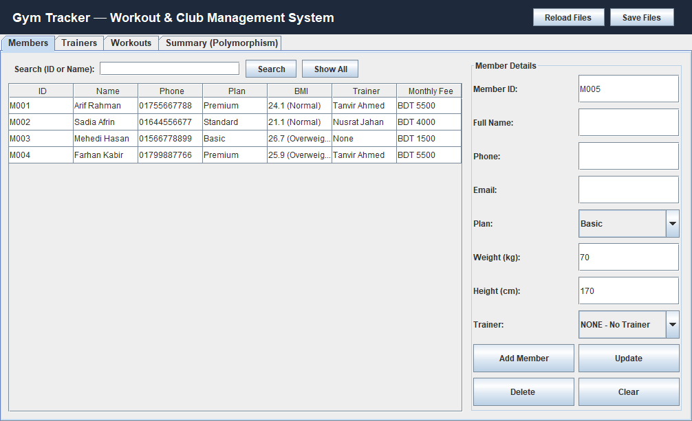
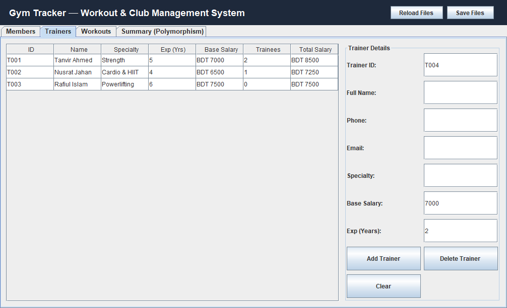
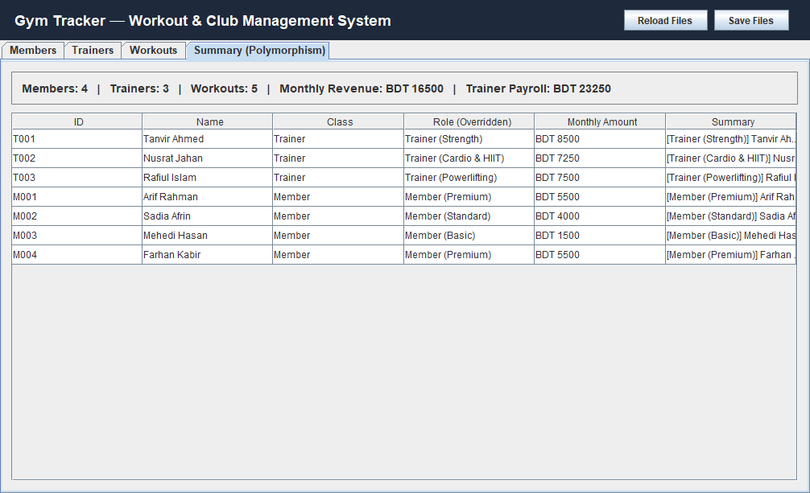

# Gym Tracker — CSE110 OOP Term Project

**East West University — Department of Computer Science and Engineering**  
**Course:** CSE110 (Object Oriented Programming)  
**Instructor:** Fouzia Risdin, Lecturer, CSE

A clean, beginner-friendly **Java Swing** desktop application demonstrating core Object-Oriented Programming principles: Encapsulation, Abstract Class, Inheritance, Interface, Association, Polymorphism (Overriding & Overloading), Generics, Collections, Exception Handling, and File I/O.

---

## Screenshots

| Members Management | Trainers Management |
| :---: | :---: |
|  |  |

| Workout Logbook (Method Overloading) | Summary (Runtime Polymorphism) |
| :---: | :---: |
|  |  |

---

## UML Diagram


---

## Project Files (`src/gym/`)
- `Identifiable.java` — Interface (`getId()`, `getSummary()`)
- `Person.java` — Abstract base class
- `Member.java` — Subclass of `Person` (BMI, `Trainer` association, `ArrayList<WorkoutLog>`, overloaded `addWorkout`)
- `Trainer.java` — Subclass of `Person` (commission calculation, assigned trainees)
- `WorkoutLog.java` — Strength & Cardio workout entity (overloaded constructors)
- `DuplicateIdException.java`, `NotFoundException.java`, `InvalidDataException.java` — 3 Custom Checked Exceptions
- `DataManager.java` — Generic class `DataManager<T extends Identifiable>` using `ArrayList` & `HashMap`
- `FileHandler.java` — File I/O persistence (`BufferedReader` / `BufferedWriter`)
- `GymGUI.java` & `Main.java` — 4-tab Java Swing GUI

---

## How to Run

### Option 1: Apache NetBeans (1-Click Open Project)
1. Open **Apache NetBeans** → **`File` → `Open Project...`**
2. Select `CSE110-Gym-Management-System` → click **Open Project**.
3. Press **`F6`** (Run) to launch `gym.Main`.

### Option 2: Windows Launcher
Double-click **`run.bat`**.

### Option 3: Terminal
```bash
mkdir out
javac --release 11 -d out src/gym/*.java
java -cp out gym.Main
```

---

## Report & Submission
Open `docs/CSE110_Project_Report_Printable.html` in Chrome/Edge, fill in your **Name, Student ID, and Section**, and press **Ctrl + P → Save as PDF**.
