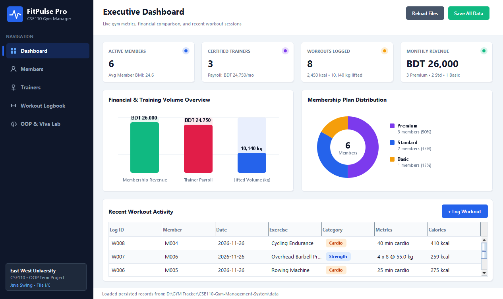
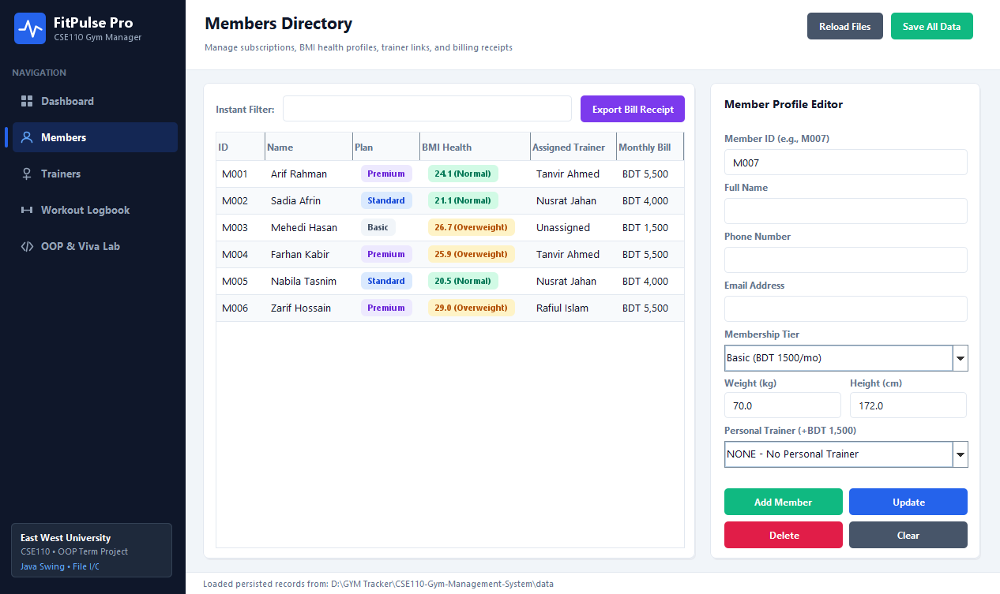
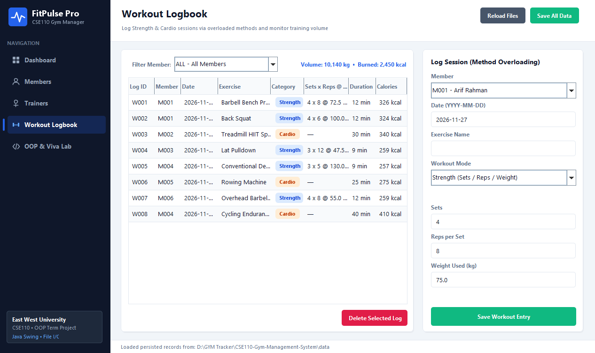
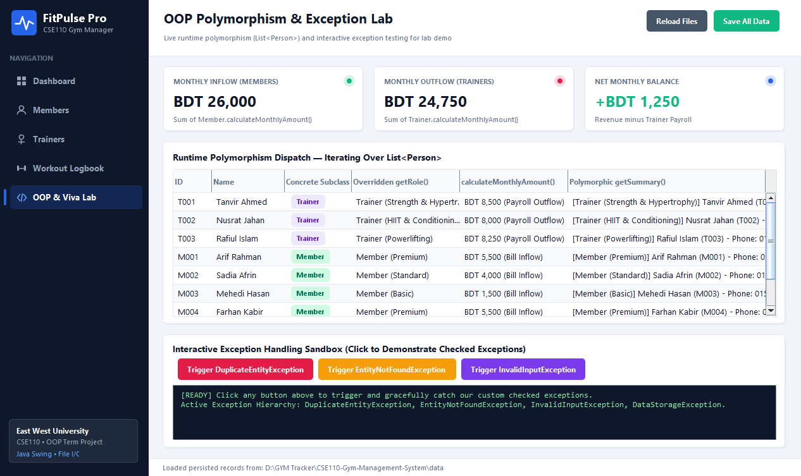

# FitPulse Pro — Gym & Workout Management System


**East West University — Department of Computer Science and Engineering**  
**Course:** CSE110 (Object Oriented Programming)  
**Course Instructor:** Fouzia Risdin, Lecturer, CSE

FitPulse Pro is a pure Java desktop application (zero external JAR dependencies) demonstrating textbook **Object-Oriented Programming** through an executive-style **Java Swing + Java2D** gym management dashboard, live financial analytics, BMI health tracking, printable billing receipts, and text-file persistence.

---

## Live Application Preview

| Executive Dashboard (Live Java2D Charts) | Members Directory (Pill Badges, BMI & Receipts) |
| :---: | :---: |
|  |  |

| Dual-Mode Workout Logbook (Method Overloading) | OOP Polymorphism & Interactive Exception Lab |
| :---: | :---: |
|  |  |

---

## UML 2.0 Class Diagram


---

## OOP & CSE110 Rubric Coverage (5 / 5 Marks)

| Requirement / Rubric Criterion | Implementation in FitPulse Pro |
| :--- | :--- |
| **Classes, Objects & Encapsulation** | 19 modular classes/interfaces/enums across 5 packages (`gym.model`, `gym.exception`, `gym.repository`, `gym.service`, `gym.ui`); all domain fields are `private` with public getters & setters. |
| **Abstract Class & Inheritance** | `abstract class Person` defines common attributes and abstract methods (`getRole()`, `calculateMonthlyAmount()`), extended by `Member` and `Trainer`. |
| **Interfaces** | `Identifiable` (`getId()`, `getSummary()`) and `Persistable` (`toFileRecord()`). |
| **Association, Aggregation & Composition** | **Aggregation:** `Member` holds a direct `Trainer` object reference (`0..*` to `0..1`), and `Trainer` holds `List<Member>`.<br>**Composition:** `Member` owns `List<WorkoutLog>` (`1` to `0..*`), and `GymService` owns its repositories & `FileStorageService`. |
| **Polymorphism** | **Method Overriding (Runtime):** `getRole()`, `calculateMonthlyAmount()`, and `getSummary()` dispatched over `List<Person>`.<br>**Method Overloading (Compile-Time):** 3 overloaded `logWorkout(...)` methods in `Member`, 2 in `GymService`, and overloaded Strength/Cardio constructors in `WorkoutLog`. |
| **Collections & Generics** | Bounded generic class `DataRepository<T extends Identifiable>` backed by `LinkedHashMap<String, T>` and `ArrayList<T>`, plus wildcard generic `List<? extends Persistable>` in `FileStorageService`. |
| **File Handling** | `BufferedReader` / `BufferedWriter` auto-persistence (`data/members.txt`, `data/trainers.txt`, `data/workouts.txt`) plus 1-click printable invoice export (`receipts/<ID>_receipt.txt`). |
| **Exception Handling (6 Types)** | 4 custom checked exceptions (`DuplicateEntityException`, `EntityNotFoundException`, `InvalidInputException`, `DataStorageException`) + `NumberFormatException` + `IOException`. |
| **Bonus GUI** | 5-screen executive Java Swing + Java2D dashboard with custom vector icons, rounded cards, live bar/donut charts, colored pill badges, and instant search. |

---

## Quick Start (How to Run)

### Option 1: 1-Click Windows Launcher
Double-click **`run.bat`**, or run in PowerShell / Command Prompt:
```bat
.\run.bat
```

### Option 2: Manual Terminal Compilation (Works on JDK 11–25)
```bash
mkdir out
javac --release 11 -d out src/gym/*.java src/gym/model/*.java src/gym/exception/*.java src/gym/repository/*.java src/gym/service/*.java src/gym/ui/*.java
java -cp out gym.Main
```

### Option 3: Run Automated Verification Suite
```bash
java -cp out gym.GymSystemSelfTest
```

---

## Project Report & Submission Files
- **Printable Submission Report (with Vector UML, Screenshots & Full Source Code):** Open `docs/CSE110_Project_Report_Printable.html` in Chrome/Edge, fill in your Name / Student ID / Section, and press **Ctrl + P → Save as PDF**.
- **Markdown Report:** `docs/CSE110_Project_Report.md`
- **Standalone Vector UML Diagram:** `docs/UML_Class_Diagram.svg`
