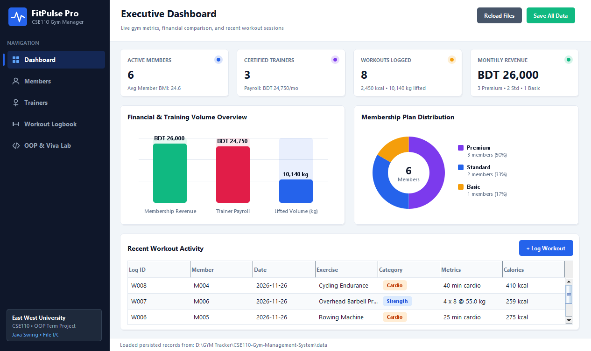
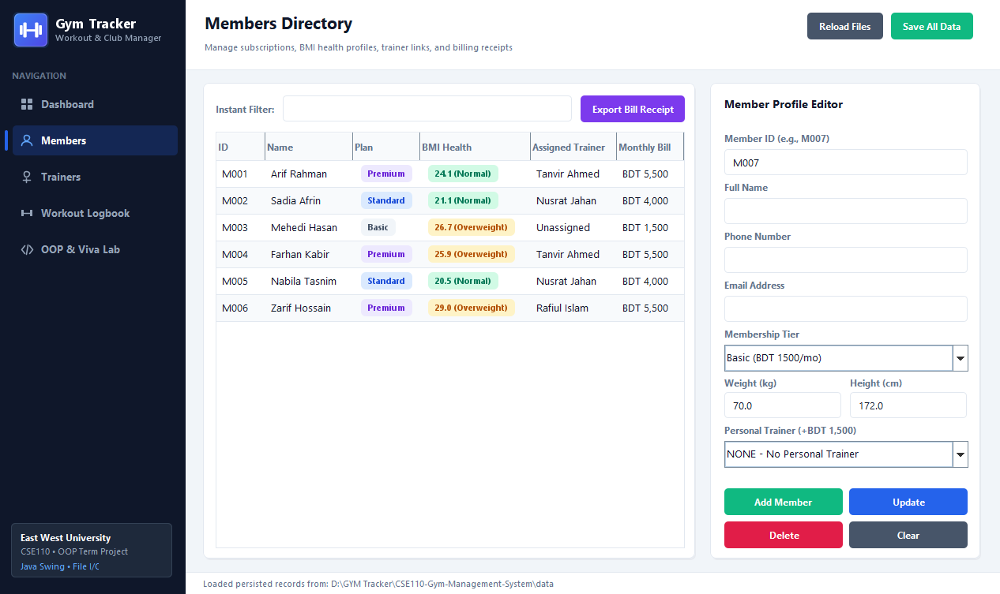
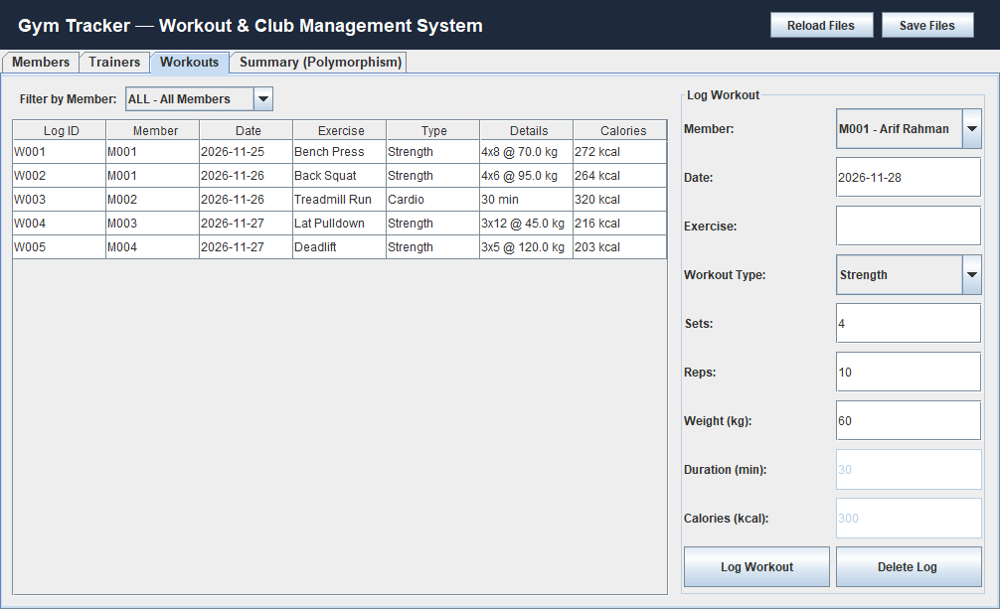
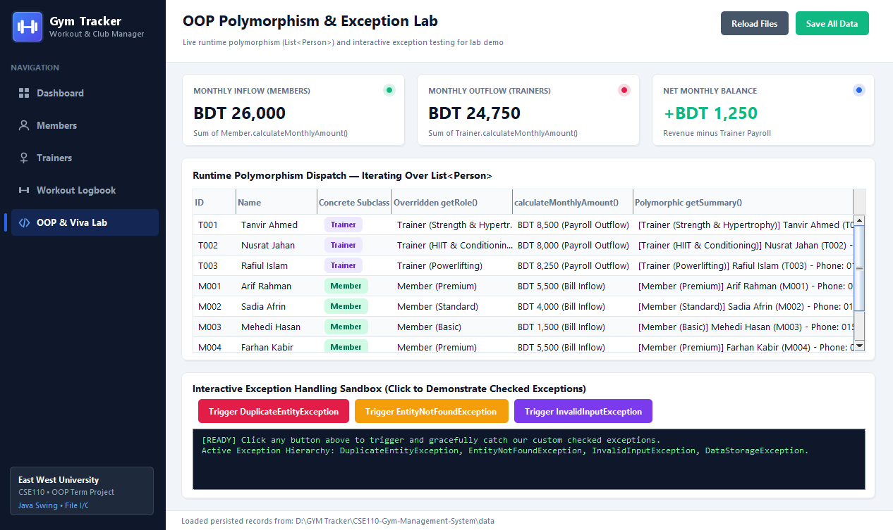

# East West University
## Department of Computer Science and Engineering
### CSE110 (Object Oriented Programming) — Term Project Report

- **Project Title:** Gym Tracker — Workout & Club Management System
- **Course Code:** CSE110 (Object Oriented Programming)
- **Course Instructor:** Fouzia Risdin, Lecturer, CSE
- **Submitted By:** `[Your Full Name]`, ID: `[Your Student ID]`, Section: `[Your Section]`

---

## 1. Introduction & Topic Description
**Gym Tracker** is an object-oriented desktop application written in pure **Java (JDK 11+)** with a custom Java2D **Java Swing** graphical user interface. It streamlines gym operations by managing member subscriptions, BMI health analytics, certified trainers and commissions, dual-mode strength & cardio workout tracking, printable billing receipts, and live financial reporting—all backed by human-readable text-file persistence.

---

## 2. Core Features
1. **Executive Analytics Dashboard:** Displays real-time KPI cards, a custom Java2D **Financial & Volume Bar Chart**, a **Membership Tier Donut Chart**, and a live recent workout activity stream.
2. **Members Directory & Health Analytics:** Full CRUD operations with instant search-as-you-type, `Basic` / `Standard` / `Premium` tiers, automatic **BMI calculation & health category badges**, personal trainer linking, and **1-click printable `.txt` Billing Receipt export**.
3. **Trainers & Commission Payroll:** Manage certified trainers, specialties, and base salaries with live bidirectional member assignment (`+BDT 750` commission per trainee).
4. **Dual-Mode Workout Logbook:** Overloaded `logWorkout(...)` methods supporting both **Strength** (`sets`, `reps`, `weightKg`) and **Cardio** (`durationMinutes`, `caloriesBurned`) sessions.
5. **Interactive OOP & Exception Viva Lab:** Dedicated screen iterating over a polymorphic `List<Person>` (`Member` & `Trainer`) plus interactive buttons to trigger and gracefully catch all custom checked exceptions.
6. **File I/O Persistence:** Automatic `BufferedReader` / `BufferedWriter` persistence to `data/members.txt`, `data/trainers.txt`, `data/workouts.txt`, and `receipts/<ID>_receipt.txt`.

---

## 3. Application Screenshots






---

## 4. Object-Oriented Design & Rubric Mapping (5 / 5 Criteria)
- **Classes, Objects & Encapsulation:** 19 modular classes/interfaces/enums with `private` attributes and controlled `public` getters/setters.
- **Abstract Class & Inheritance:** `abstract class Person` defines shared state (`id`, `name`, `phone`, `email`) and abstract methods (`getRole()`, `calculateMonthlyAmount()`), extended by `Member` and `Trainer`.
- **Interfaces:** `Identifiable` (`getId()`, `getSummary()`) and `Persistable` (`toFileRecord()`).
- **Association, Aggregation & Composition:**
  - *Aggregation:* `Member` holds an object reference `Trainer assignedTrainer` (`0..*` to `0..1`), and `Trainer` holds `List<Member> assignedMembers`.
  - *Composition:* `Member` owns `List<WorkoutLog> workoutLogs` (`1` to `0..*`), and `GymService` owns its repositories and `FileStorageService`.
- **Polymorphism:**
  - *Runtime (Method Overriding):* `getRole()`, `calculateMonthlyAmount()`, and `getSummary()` overridden by `Member` & `Trainer` and dispatched via `List<Person>`.
  - *Compile-Time (Overloading):* 3 overloaded `logWorkout(...)` methods in `Member`, overloaded `logWorkout(...)` in `GymService`, and overloaded Strength/Cardio constructors in `WorkoutLog`.
- **Collections & Bounded Generics:** `DataRepository<T extends Identifiable>` backed by `LinkedHashMap<String, T>` and `ArrayList<T>`, plus wildcard generic `List<? extends Persistable>` in `FileStorageService`.
- **Exception Handling (6 Handled Types):** `DuplicateEntityException`, `EntityNotFoundException`, `InvalidInputException`, `DataStorageException`, `NumberFormatException`, and `IOException`.

---

## 5. UML Diagram


---

## 6. Complete Java Source Code

### `src/gym/Main.java`
```java
package gym;

import gym.exception.DataStorageException;
import gym.service.FileStorageService;
import gym.service.GymService;
import gym.ui.GymManagementFrame;

import javax.swing.JOptionPane;
import javax.swing.SwingUtilities;
import javax.swing.UIManager;
import java.io.File;

/**
 * Application entry point for Gym Tracker — Workout & Club Management System.
 * Course: CSE110 (Object Oriented Programming) — East West University.
 */
public class Main {
    public static void main(String[] args) {
        try {
            UIManager.setLookAndFeel(UIManager.getCrossPlatformLookAndFeelClassName());
        } catch (Exception ignored) {
        }

        SwingUtilities.invokeLater(() -> {
            String dataDir = new File("data").getPath();
            FileStorageService storageService = new FileStorageService(dataDir);
            GymService gymService = new GymService(storageService);

            try {
                gymService.initialize();
            } catch (DataStorageException ex) {
                JOptionPane.showMessageDialog(null,
                        "Storage Warning: " + ex.getMessage(),
                        "Startup File Warning",
                        JOptionPane.WARNING_MESSAGE);
            }

            GymManagementFrame frame = new GymManagementFrame(gymService);
            frame.setVisible(true);
        });
    }
}

```

### `src/gym/model/Identifiable.java`
```java
package gym.model;

/**
 * Interface representing any domain entity that has a unique ID and summary.
 * Demonstrates: Interface (Rubric Criterion 2).
 */
public interface Identifiable {
    String getId();
    String getSummary();
}

```

### `src/gym/model/Persistable.java`
```java
package gym.model;

/**
 * Interface for entities that can be serialized into a text file line.
 * Demonstrates: Interface & File Handling support (Rubric Criteria 2 & 3).
 */
public interface Persistable {
    String toFileRecord();
}

```

### `src/gym/model/MembershipPlan.java`
```java
package gym.model;

/**
 * Enum representing available gym membership tiers and their base monthly fees (BDT).
 */
public enum MembershipPlan {
    BASIC("Basic", 1500.0),
    STANDARD("Standard", 2500.0),
    PREMIUM("Premium", 4000.0);

    private final String displayName;
    private final double monthlyFee;

    MembershipPlan(String displayName, double monthlyFee) {
        this.displayName = displayName;
        this.monthlyFee = monthlyFee;
    }

    public String getDisplayName() {
        return displayName;
    }

    public double getMonthlyFee() {
        return monthlyFee;
    }

    @Override
    public String toString() {
        return displayName + " (BDT " + String.format("%.0f", monthlyFee) + "/mo)";
    }
}

```

### `src/gym/model/Person.java`
```java
package gym.model;

/**
 * Abstract base class representing a person associated with the gym.
 * Demonstrates:
 * - Abstract Class (Rubric Criterion 2)
 * - Encapsulation via private fields + getters/setters (Requirement 1)
 * - Interface implementation (Identifiable, Persistable)
 */
public abstract class Person implements Identifiable, Persistable {
    private String id;
    private String name;
    private String phone;
    private String email;

    public Person(String id, String name, String phone, String email) {
        this.id = id;
        this.name = name;
        this.phone = phone;
        this.email = email;
    }

    // Encapsulated Getters and Setters
    @Override
    public String getId() {
        return id;
    }

    public void setId(String id) {
        this.id = id;
    }

    public String getName() {
        return name;
    }

    public void setName(String name) {
        this.name = name;
    }

    public String getPhone() {
        return phone;
    }

    public void setPhone(String phone) {
        this.phone = phone;
    }

    public String getEmail() {
        return email;
    }

    public void setEmail(String email) {
        this.email = email;
    }

    /**
     * Abstract method overridden by subclasses (Member, Trainer) to return their role.
     */
    public abstract String getRole();

    /**
     * Polymorphic calculation:
     * - For a Member: returns monthly membership bill (+ trainer fee if assigned).
     * - For a Trainer: returns monthly salary (+ bonus per assigned member).
     */
    public abstract double calculateMonthlyAmount();

    @Override
    public String getSummary() {
        return String.format("[%s] %s (%s) - Phone: %s", getRole(), name, id, phone);
    }
}

```

### `src/gym/model/Member.java`
```java
package gym.model;

import java.time.LocalDate;
import java.util.ArrayList;
import java.util.List;

/**
 * Represents a registered gym member.
 * Demonstrates:
 * - Inheritance: extends abstract class Person
 * - Polymorphism: overrides getRole(), calculateMonthlyAmount(), getSummary()
 * - Method Overloading: 3 overloaded logWorkout(...) methods
 * - Composition: owns List<WorkoutLog>
 * - Aggregation / Association: holds an object reference to Trainer and MembershipPlan
 */
public class Member extends Person {
    public static final double PERSONAL_TRAINER_FEE = 1500.0;

    private MembershipPlan plan;
    private double weightKg;
    private double heightCm;
    private Trainer assignedTrainer; // True OOP Object Association (Aggregation)
    private final List<WorkoutLog> workoutLogs; // True OOP Composition

    public Member(String id, String name, String phone, String email,
                  MembershipPlan plan, double weightKg, double heightCm, Trainer assignedTrainer) {
        super(id, name, phone, email);
        this.plan = plan;
        this.weightKg = weightKg;
        this.heightCm = heightCm;
        this.assignedTrainer = assignedTrainer;
        this.workoutLogs = new ArrayList<>();
    }

    public MembershipPlan getPlan() {
        return plan;
    }

    public void setPlan(MembershipPlan plan) {
        this.plan = plan;
    }

    public double getWeightKg() {
        return weightKg;
    }

    public void setWeightKg(double weightKg) {
        this.weightKg = weightKg;
    }

    public double getHeightCm() {
        return heightCm;
    }

    public void setHeightCm(double heightCm) {
        this.heightCm = heightCm;
    }

    public Trainer getAssignedTrainer() {
        return assignedTrainer;
    }

    public void setAssignedTrainer(Trainer assignedTrainer) {
        this.assignedTrainer = assignedTrainer;
    }

    public boolean hasPersonalTrainer() {
        return assignedTrainer != null;
    }

    public String getAssignedTrainerId() {
        return assignedTrainer != null ? assignedTrainer.getId() : "NONE";
    }

    public String getAssignedTrainerName() {
        return assignedTrainer != null ? assignedTrainer.getName() : "Unassigned";
    }

    public List<WorkoutLog> getWorkoutLogs() {
        return new ArrayList<>(workoutLogs);
    }

    public void clearWorkoutLogs() {
        workoutLogs.clear();
    }

    // --- Health Analytics (Encapsulated Business Logic) ---

    public double calculateBMI() {
        if (heightCm <= 0) {
            return 0.0;
        }
        double heightMeters = heightCm / 100.0;
        return weightKg / (heightMeters * heightMeters);
    }

    public String getBmiCategory() {
        double bmi = calculateBMI();
        if (bmi < 18.5) return "Underweight";
        if (bmi < 25.0) return "Normal";
        if (bmi < 30.0) return "Overweight";
        return "Obese";
    }

    // --- Method Overloading (Compile-Time Polymorphism) ---

    /**
     * Overloaded Method 1: Adds an existing WorkoutLog instance.
     */
    public void logWorkout(WorkoutLog log) {
        if (log != null) {
            workoutLogs.add(log);
        }
    }

    /**
     * Overloaded Method 2: Creates and logs a Strength workout directly.
     */
    public WorkoutLog logWorkout(String logId, String date, String exerciseName,
                                 int sets, int reps, double weightUsedKg) {
        WorkoutLog log = new WorkoutLog(logId, getId(), date, exerciseName, sets, reps, weightUsedKg);
        workoutLogs.add(log);
        return log;
    }

    /**
     * Overloaded Method 3: Creates and logs a Cardio workout directly.
     */
    public WorkoutLog logWorkout(String logId, String date, String exerciseName,
                                 int durationMinutes, int caloriesBurned) {
        WorkoutLog log = new WorkoutLog(logId, getId(), date, exerciseName, durationMinutes, caloriesBurned);
        workoutLogs.add(log);
        return log;
    }

    public int getTotalCaloriesBurned() {
        int total = 0;
        for (WorkoutLog log : workoutLogs) {
            total += log.getCaloriesBurned();
        }
        return total;
    }

    public double getTotalVolumeKg() {
        double total = 0.0;
        for (WorkoutLog log : workoutLogs) {
            total += log.calculateVolumeKg();
        }
        return total;
    }

    public String generateReceiptText() {
        StringBuilder sb = new StringBuilder();
        sb.append("====================================================\n");
        sb.append("      GYM TRACKER — WORKOUT & CLUB MANAGEMENT       \n");
        sb.append("             OFFICIAL MONTHLY BILL RECEIPT          \n");
        sb.append("====================================================\n");
        sb.append(String.format("Issue Date       : %s%n", LocalDate.now()));
        sb.append(String.format("Member ID        : %s%n", getId()));
        sb.append(String.format("Member Name      : %s%n", getName()));
        sb.append(String.format("Phone / Email    : %s | %s%n", getPhone(), getEmail()));
        sb.append(String.format("Health Profile   : %.1f kg | %.0f cm | BMI %.1f (%s)%n",
                weightKg, heightCm, calculateBMI(), getBmiCategory()));
        sb.append("----------------------------------------------------\n");
        sb.append(String.format("Membership Plan  : %-18s BDT %8.2f%n",
                plan.getDisplayName(), plan.getMonthlyFee()));
        if (hasPersonalTrainer()) {
            sb.append(String.format("Personal Trainer : %-18s BDT %8.2f%n",
                    assignedTrainer.getName(), PERSONAL_TRAINER_FEE));
        } else {
            sb.append(String.format("Personal Trainer : %-18s BDT %8.2f%n", "None", 0.0));
        }
        sb.append("----------------------------------------------------\n");
        sb.append(String.format("TOTAL MONTHLY DUE:                    BDT %8.2f%n", calculateMonthlyAmount()));
        sb.append("====================================================\n");
        sb.append(String.format("Workouts Logged: %d | Total Volume: %.0f kg | Burned: %d kcal%n",
                workoutLogs.size(), getTotalVolumeKg(), getTotalCaloriesBurned()));
        sb.append("Thank you for training with Gym Tracker!\n");
        return sb.toString();
    }

    // --- Method Overriding (Runtime Polymorphism) ---

    @Override
    public String getRole() {
        return "Member (" + plan.getDisplayName() + ")";
    }

    @Override
    public double calculateMonthlyAmount() {
        double total = plan.getMonthlyFee();
        if (hasPersonalTrainer()) {
            total += PERSONAL_TRAINER_FEE;
        }
        return total;
    }

    @Override
    public String getSummary() {
        return String.format("%s | BMI: %.1f (%s) | Trainer: %s | Bill: BDT %.0f",
                super.getSummary(), calculateBMI(), getBmiCategory(),
                getAssignedTrainerName(), calculateMonthlyAmount());
    }

    @Override
    public String toFileRecord() {
        return String.join("|",
                getId(),
                getName().replace("|", "/"),
                getPhone().replace("|", "/"),
                getEmail().replace("|", "/"),
                plan.name(),
                String.valueOf(weightKg),
                String.valueOf(heightCm),
                getAssignedTrainerId());
    }
}

```

### `src/gym/model/Trainer.java`
```java
package gym.model;

import java.util.ArrayList;
import java.util.List;

/**
 * Represents a certified gym trainer.
 * Demonstrates:
 * - Inheritance: extends abstract class Person
 * - Polymorphism: overrides getRole(), calculateMonthlyAmount(), getSummary()
 * - Aggregation / Association: maintains List<Member> of assigned trainees
 */
public class Trainer extends Person {
    public static final double COMMISSION_PER_TRAINEE = 750.0;

    private String specialty;
    private double baseSalary;
    private int experienceYears;
    private final List<Member> assignedMembers; // True OOP Object Association

    public Trainer(String id, String name, String phone, String email,
                   String specialty, double baseSalary, int experienceYears) {
        super(id, name, phone, email);
        this.specialty = specialty;
        this.baseSalary = baseSalary;
        this.experienceYears = experienceYears;
        this.assignedMembers = new ArrayList<>();
    }

    public String getSpecialty() {
        return specialty;
    }

    public void setSpecialty(String specialty) {
        this.specialty = specialty;
    }

    public double getBaseSalary() {
        return baseSalary;
    }

    public void setBaseSalary(double baseSalary) {
        this.baseSalary = baseSalary;
    }

    public int getExperienceYears() {
        return experienceYears;
    }

    public void setExperienceYears(int experienceYears) {
        this.experienceYears = experienceYears;
    }

    public void addAssignedMember(Member member) {
        if (member != null && !assignedMembers.contains(member)) {
            assignedMembers.add(member);
        }
    }

    public void removeAssignedMember(Member member) {
        assignedMembers.remove(member);
    }

    public void clearAssignedMembers() {
        assignedMembers.clear();
    }

    public List<Member> getAssignedMembers() {
        return new ArrayList<>(assignedMembers);
    }

    public int getAssignedMemberCount() {
        return assignedMembers.size();
    }

    @Override
    public String getRole() {
        return "Trainer (" + specialty + ")";
    }

    @Override
    public double calculateMonthlyAmount() {
        return baseSalary + (assignedMembers.size() * COMMISSION_PER_TRAINEE);
    }

    @Override
    public String getSummary() {
        return String.format("%s | Exp: %d yrs | Trainees: %d | Monthly Payout: BDT %.0f",
                super.getSummary(), experienceYears, assignedMembers.size(), calculateMonthlyAmount());
    }

    @Override
    public String toFileRecord() {
        return String.join("|",
                getId(),
                getName().replace("|", "/"),
                getPhone().replace("|", "/"),
                getEmail().replace("|", "/"),
                specialty.replace("|", "/"),
                String.valueOf(baseSalary),
                String.valueOf(experienceYears));
    }

    public static Trainer fromFileRecord(String line) {
        String[] parts = line.split("\\|", -1);
        if (parts.length < 7) {
            throw new IllegalArgumentException("Malformed trainer record: " + line);
        }
        return new Trainer(
                parts[0].trim(),
                parts[1].trim(),
                parts[2].trim(),
                parts[3].trim(),
                parts[4].trim(),
                Double.parseDouble(parts[5].trim()),
                Integer.parseInt(parts[6].trim())
        );
    }

    @Override
    public String toString() {
        return getId() + " - " + getName() + " (" + specialty + ")";
    }
}

```

### `src/gym/model/WorkoutLog.java`
```java
package gym.model;

/**
 * Represents an individual workout entry logged by a gym member.
 * Demonstrates:
 * - Core Class with Encapsulation (Requirement 1)
 * - Method / Constructor Overloading for Strength vs Cardio workouts (Requirement 2)
 */
public class WorkoutLog implements Identifiable, Persistable {
    private String logId;
    private String memberId;
    private String date;
    private String exerciseName;
    private String category; // "Strength" or "Cardio"
    private int sets;
    private int reps;
    private double weightUsedKg;
    private int durationMinutes;
    private int caloriesBurned;

    // Full constructor (used when loading from file)
    public WorkoutLog(String logId, String memberId, String date, String exerciseName,
                      String category, int sets, int reps, double weightUsedKg,
                      int durationMinutes, int caloriesBurned) {
        this.logId = logId;
        this.memberId = memberId;
        this.date = date;
        this.exerciseName = exerciseName;
        this.category = category;
        this.sets = sets;
        this.reps = reps;
        this.weightUsedKg = weightUsedKg;
        this.durationMinutes = durationMinutes;
        this.caloriesBurned = caloriesBurned;
    }

    // Overloaded Constructor 1: Strength Workout
    public WorkoutLog(String logId, String memberId, String date, String exerciseName,
                      int sets, int reps, double weightUsedKg) {
        this(logId, memberId, date, exerciseName, "Strength", sets, reps, weightUsedKg,
                sets * 3, (int) Math.round(sets * reps * (weightUsedKg * 0.12 + 1.5)));
    }

    // Overloaded Constructor 2: Cardio Workout
    public WorkoutLog(String logId, String memberId, String date, String exerciseName,
                      int durationMinutes, int caloriesBurned) {
        this(logId, memberId, date, exerciseName, "Cardio", 0, 0, 0.0,
                durationMinutes, caloriesBurned);
    }

    @Override
    public String getId() {
        return logId;
    }

    public void setLogId(String logId) {
        this.logId = logId;
    }

    public String getMemberId() {
        return memberId;
    }

    public void setMemberId(String memberId) {
        this.memberId = memberId;
    }

    public String getDate() {
        return date;
    }

    public void setDate(String date) {
        this.date = date;
    }

    public String getExerciseName() {
        return exerciseName;
    }

    public void setExerciseName(String exerciseName) {
        this.exerciseName = exerciseName;
    }

    public String getCategory() {
        return category;
    }

    public void setCategory(String category) {
        this.category = category;
    }

    public int getSets() {
        return sets;
    }

    public void setSets(int sets) {
        this.sets = sets;
    }

    public int getReps() {
        return reps;
    }

    public void setReps(int reps) {
        this.reps = reps;
    }

    public double getWeightUsedKg() {
        return weightUsedKg;
    }

    public void setWeightUsedKg(double weightUsedKg) {
        this.weightUsedKg = weightUsedKg;
    }

    public int getDurationMinutes() {
        return durationMinutes;
    }

    public void setDurationMinutes(int durationMinutes) {
        this.durationMinutes = durationMinutes;
    }

    public int getCaloriesBurned() {
        return caloriesBurned;
    }

    public void setCaloriesBurned(int caloriesBurned) {
        this.caloriesBurned = caloriesBurned;
    }

    /**
     * Calculates total lifted volume (sets * reps * weight) for strength exercises.
     */
    public double calculateVolumeKg() {
        return sets * reps * weightUsedKg;
    }

    @Override
    public String getSummary() {
        if ("Strength".equalsIgnoreCase(category)) {
            return String.format("%s | %s (%d x %d @ %.1f kg)", date, exerciseName, sets, reps, weightUsedKg);
        }
        return String.format("%s | %s (%d min, %d kcal)", date, exerciseName, durationMinutes, caloriesBurned);
    }

    @Override
    public String toFileRecord() {
        return String.join("|",
                logId,
                memberId,
                date,
                exerciseName.replace("|", "/"),
                category,
                String.valueOf(sets),
                String.valueOf(reps),
                String.valueOf(weightUsedKg),
                String.valueOf(durationMinutes),
                String.valueOf(caloriesBurned));
    }

    public static WorkoutLog fromFileRecord(String line) {
        String[] parts = line.split("\\|", -1);
        if (parts.length < 10) {
            throw new IllegalArgumentException("Malformed workout record: " + line);
        }
        return new WorkoutLog(
                parts[0].trim(),
                parts[1].trim(),
                parts[2].trim(),
                parts[3].trim(),
                parts[4].trim(),
                Integer.parseInt(parts[5].trim()),
                Integer.parseInt(parts[6].trim()),
                Double.parseDouble(parts[7].trim()),
                Integer.parseInt(parts[8].trim()),
                Integer.parseInt(parts[9].trim())
        );
    }
}

```

### `src/gym/exception/DuplicateEntityException.java`
```java
package gym.exception;

/**
 * Custom checked exception thrown when attempting to add an entity with a duplicate ID.
 * Demonstrates: Custom Exception Handling (Requirement 4 & Rubric Criterion 3).
 */
public class DuplicateEntityException extends Exception {
    public DuplicateEntityException(String message) {
        super(message);
    }
}

```

### `src/gym/exception/EntityNotFoundException.java`
```java
package gym.exception;

/**
 * Custom checked exception thrown when a requested entity ID cannot be found.
 * Demonstrates: Custom Exception Handling (Requirement 4 & Rubric Criterion 3).
 */
public class EntityNotFoundException extends Exception {
    public EntityNotFoundException(String message) {
        super(message);
    }
}

```

### `src/gym/exception/InvalidInputException.java`
```java
package gym.exception;

/**
 * Custom checked exception thrown when user input fails validation rules.
 * Demonstrates: Custom Exception Handling (Requirement 4 & Rubric Criterion 3).
 */
public class InvalidInputException extends Exception {
    public InvalidInputException(String message) {
        super(message);
    }
}

```

### `src/gym/exception/DataStorageException.java`
```java
package gym.exception;

/**
 * Custom checked exception thrown when reading or writing persistence files fails
 * or encounters corrupted records.
 * Demonstrates: Custom Exception Handling + File I/O error recovery.
 */
public class DataStorageException extends Exception {
    public DataStorageException(String message) {
        super(message);
    }

    public DataStorageException(String message, Throwable cause) {
        super(message, cause);
    }
}

```

### `src/gym/repository/DataRepository.java`
```java
package gym.repository;

import gym.exception.DuplicateEntityException;
import gym.exception.EntityNotFoundException;
import gym.model.Identifiable;

import java.util.ArrayList;
import java.util.LinkedHashMap;
import java.util.List;
import java.util.Map;

/**
 * Generic in-memory repository for managing Identifiable entities.
 * Demonstrates:
 * - Bounded Generics <T extends Identifiable> (Rubric Criterion 3)
 * - Java Collections: Map (LinkedHashMap/HashMap) + List (ArrayList) (Requirement 3)
 */
public class DataRepository<T extends Identifiable> {
    private final Map<String, T> storage = new LinkedHashMap<>();

    public void add(T item) throws DuplicateEntityException {
        String key = normalizeKey(item.getId());
        if (storage.containsKey(key)) {
            throw new DuplicateEntityException("An entry with ID '" + item.getId() + "' already exists.");
        }
        storage.put(key, item);
    }

    public void update(T item) throws EntityNotFoundException {
        String key = normalizeKey(item.getId());
        if (!storage.containsKey(key)) {
            throw new EntityNotFoundException("Cannot update: ID '" + item.getId() + "' was not found.");
        }
        storage.put(key, item);
    }

    public void remove(String id) throws EntityNotFoundException {
        String key = normalizeKey(id);
        if (!storage.containsKey(key)) {
            throw new EntityNotFoundException("Cannot delete: ID '" + id + "' was not found.");
        }
        storage.remove(key);
    }

    public T findById(String id) throws EntityNotFoundException {
        String key = normalizeKey(id);
        T item = storage.get(key);
        if (item == null) {
            throw new EntityNotFoundException("Record with ID '" + id + "' does not exist.");
        }
        return item;
    }

    public boolean exists(String id) {
        if (id == null) {
            return false;
        }
        return storage.containsKey(normalizeKey(id));
    }

    public List<T> getAll() {
        return new ArrayList<>(storage.values());
    }

    public void clear() {
        storage.clear();
    }

    public int count() {
        return storage.size();
    }

    private String normalizeKey(String id) {
        return id == null ? "" : id.trim().toUpperCase();
    }
}

```

### `src/gym/service/FileStorageService.java`
```java
package gym.service;

import gym.exception.DataStorageException;
import gym.model.Member;
import gym.model.MembershipPlan;
import gym.model.Persistable;
import gym.model.Trainer;
import gym.model.WorkoutLog;

import java.io.BufferedReader;
import java.io.BufferedWriter;
import java.io.File;
import java.io.FileReader;
import java.io.FileWriter;
import java.io.IOException;
import java.util.ArrayList;
import java.util.List;
import java.util.Map;

/**
 * Handles text-file persistence and formatted receipt export.
 * Demonstrates:
 * - File I/O using BufferedReader / BufferedWriter / File (Rubric Criterion 3)
 * - Wildcard Generic helper method writeRecords(File, List<? extends Persistable>)
 * - Robust Exception Handling wrapping IOException & parsing errors in DataStorageException
 */
public class FileStorageService {
    private final File dataDir;
    private final File receiptsDir;
    private final File membersFile;
    private final File trainersFile;
    private final File workoutsFile;

    public FileStorageService(String dataDirPath) {
        this.dataDir = new File(dataDirPath);
        this.receiptsDir = new File(dataDir.getParentFile() != null ? dataDir.getParentFile() : new File("."), "receipts");
        this.membersFile = new File(dataDir, "members.txt");
        this.trainersFile = new File(dataDir, "trainers.txt");
        this.workoutsFile = new File(dataDir, "workouts.txt");
    }

    public boolean hasExistingData() {
        return membersFile.exists() || trainersFile.exists() || workoutsFile.exists();
    }

    public void saveAll(List<Member> members, List<Trainer> trainers, List<WorkoutLog> workouts)
            throws DataStorageException {
        if (!dataDir.exists() && !dataDir.mkdirs()) {
            throw new DataStorageException("Unable to create data directory: " + dataDir.getAbsolutePath());
        }
        try {
            writeRecords(trainersFile, trainers);
            writeRecords(membersFile, members);
            writeRecords(workoutsFile, workouts);
        } catch (IOException ex) {
            throw new DataStorageException("Failed to save gym records to disk: " + ex.getMessage(), ex);
        }
    }

    private void writeRecords(File file, List<? extends Persistable> items) throws IOException {
        try (BufferedWriter writer = new BufferedWriter(new FileWriter(file))) {
            for (Persistable item : items) {
                writer.write(item.toFileRecord());
                writer.newLine();
            }
        }
    }

    public List<Trainer> loadTrainers() throws DataStorageException {
        List<Trainer> result = new ArrayList<>();
        if (!trainersFile.exists()) {
            return result;
        }
        try (BufferedReader reader = new BufferedReader(new FileReader(trainersFile))) {
            String line;
            int lineNumber = 0;
            while ((line = reader.readLine()) != null) {
                lineNumber++;
                String trimmed = line.trim();
                if (!trimmed.isEmpty() && !trimmed.startsWith("#")) {
                    try {
                        result.add(Trainer.fromFileRecord(trimmed));
                    } catch (IllegalArgumentException ex) {
                        throw new DataStorageException(
                                "Corrupted trainer record at line " + lineNumber + ": " + ex.getMessage(), ex);
                    }
                }
            }
        } catch (IOException ex) {
            throw new DataStorageException("Unable to read trainers.txt: " + ex.getMessage(), ex);
        }
        return result;
    }

    public List<Member> loadMembers(Map<String, Trainer> trainerLookup) throws DataStorageException {
        List<Member> result = new ArrayList<>();
        if (!membersFile.exists()) {
            return result;
        }
        try (BufferedReader reader = new BufferedReader(new FileReader(membersFile))) {
            String line;
            int lineNumber = 0;
            while ((line = reader.readLine()) != null) {
                lineNumber++;
                String trimmed = line.trim();
                if (!trimmed.isEmpty() && !trimmed.startsWith("#")) {
                    try {
                        result.add(parseMemberRecord(trimmed, trainerLookup));
                    } catch (IllegalArgumentException ex) {
                        throw new DataStorageException(
                                "Corrupted member record at line " + lineNumber + ": " + ex.getMessage(), ex);
                    }
                }
            }
        } catch (IOException ex) {
            throw new DataStorageException("Unable to read members.txt: " + ex.getMessage(), ex);
        }
        return result;
    }

    private Member parseMemberRecord(String line, Map<String, Trainer> trainerLookup) {
        String[] parts = line.split("\\|", -1);
        if (parts.length < 7) {
            throw new IllegalArgumentException("Expected at least 7 columns, found " + parts.length);
        }
        String id = parts[0].trim();
        String name = parts[1].trim();
        String phone = parts[2].trim();
        String email = parts[3].trim();
        MembershipPlan plan = MembershipPlan.valueOf(parts[4].trim().toUpperCase());
        double weightKg = Double.parseDouble(parts[5].trim());
        double heightCm = (parts.length >= 8) ? Double.parseDouble(parts[6].trim()) : 170.0;
        String trainerId = (parts.length >= 8) ? parts[7].trim() : parts[6].trim();

        Trainer trainer = null;
        if (!trainerId.isEmpty() && !trainerId.equalsIgnoreCase("NONE") && trainerLookup != null) {
            trainer = trainerLookup.get(trainerId.toUpperCase());
        }
        return new Member(id, name, phone, email, plan, weightKg, heightCm, trainer);
    }

    public List<WorkoutLog> loadWorkouts() throws DataStorageException {
        List<WorkoutLog> result = new ArrayList<>();
        if (!workoutsFile.exists()) {
            return result;
        }
        try (BufferedReader reader = new BufferedReader(new FileReader(workoutsFile))) {
            String line;
            int lineNumber = 0;
            while ((line = reader.readLine()) != null) {
                lineNumber++;
                String trimmed = line.trim();
                if (!trimmed.isEmpty() && !trimmed.startsWith("#")) {
                    try {
                        result.add(WorkoutLog.fromFileRecord(trimmed));
                    } catch (IllegalArgumentException ex) {
                        throw new DataStorageException(
                                "Corrupted workout record at line " + lineNumber + ": " + ex.getMessage(), ex);
                    }
                }
            }
        } catch (IOException ex) {
            throw new DataStorageException("Unable to read workouts.txt: " + ex.getMessage(), ex);
        }
        return result;
    }

    /**
     * Exports a formatted billing invoice for a member into receipts/<ID>_receipt.txt.
     */
    public File exportMemberReceipt(Member member) throws DataStorageException {
        if (!receiptsDir.exists() && !receiptsDir.mkdirs()) {
            throw new DataStorageException("Unable to create receipts directory: " + receiptsDir.getAbsolutePath());
        }
        File outFile = new File(receiptsDir, member.getId() + "_receipt.txt");
        try (BufferedWriter writer = new BufferedWriter(new FileWriter(outFile))) {
            writer.write(member.generateReceiptText());
            return outFile;
        } catch (IOException ex) {
            throw new DataStorageException("Could not export receipt for " + member.getId() + ": " + ex.getMessage(), ex);
        }
    }

    public String getDataDirectoryPath() {
        return dataDir.getAbsolutePath();
    }
}

```

### `src/gym/service/GymService.java`
```java
package gym.service;

import gym.exception.DataStorageException;
import gym.exception.DuplicateEntityException;
import gym.exception.EntityNotFoundException;
import gym.exception.InvalidInputException;
import gym.model.Member;
import gym.model.MembershipPlan;
import gym.model.Person;
import gym.model.Trainer;
import gym.model.WorkoutLog;
import gym.repository.DataRepository;

import java.io.File;
import java.time.LocalDate;
import java.util.ArrayList;
import java.util.HashMap;
import java.util.List;
import java.util.Map;

/**
 * Central service orchestrating Gym operations, validations, object associations,
 * dashboard analytics, and file persistence.
 */
public class GymService {
    private final DataRepository<Member> memberRepo = new DataRepository<>();
    private final DataRepository<Trainer> trainerRepo = new DataRepository<>();
    private final DataRepository<WorkoutLog> workoutRepo = new DataRepository<>();
    private final FileStorageService storageService;

    public GymService(FileStorageService storageService) {
        this.storageService = storageService;
    }

    // --- Initialization & Persistence ---

    public void initialize() throws DataStorageException {
        if (storageService.hasExistingData()) {
            reloadFromDisk();
        } else {
            seedSampleData();
            saveToDisk();
        }
    }

    public void reloadFromDisk() throws DataStorageException {
        memberRepo.clear();
        trainerRepo.clear();
        workoutRepo.clear();

        Map<String, Trainer> trainerLookup = new HashMap<>();
        for (Trainer trainer : storageService.loadTrainers()) {
            try {
                trainerRepo.add(trainer);
                trainerLookup.put(trainer.getId().toUpperCase(), trainer);
            } catch (DuplicateEntityException ex) {
                throw new DataStorageException("Duplicate trainer found in trainers.txt: " + ex.getMessage(), ex);
            }
        }

        for (Member member : storageService.loadMembers(trainerLookup)) {
            try {
                memberRepo.add(member);
            } catch (DuplicateEntityException ex) {
                throw new DataStorageException("Duplicate member found in members.txt: " + ex.getMessage(), ex);
            }
        }

        for (WorkoutLog log : storageService.loadWorkouts()) {
            try {
                workoutRepo.add(log);
                if (memberRepo.exists(log.getMemberId())) {
                    memberRepo.findById(log.getMemberId()).logWorkout(log);
                }
            } catch (DuplicateEntityException | EntityNotFoundException ex) {
                throw new DataStorageException("Invalid workout link in workouts.txt: " + ex.getMessage(), ex);
            }
        }
        syncAssociations();
    }

    public void saveToDisk() throws DataStorageException {
        storageService.saveAll(memberRepo.getAll(), trainerRepo.getAll(), workoutRepo.getAll());
    }

    public File exportMemberReceipt(String memberId) throws EntityNotFoundException, DataStorageException {
        Member member = memberRepo.findById(memberId);
        return storageService.exportMemberReceipt(member);
    }

    /**
     * Synchronizes bidirectional Member <-> Trainer object associations.
     */
    private void syncAssociations() {
        for (Trainer trainer : trainerRepo.getAll()) {
            trainer.clearAssignedMembers();
        }
        for (Member member : memberRepo.getAll()) {
            Trainer assigned = member.getAssignedTrainer();
            if (assigned != null && trainerRepo.exists(assigned.getId())) {
                assigned.addAssignedMember(member);
            } else {
                member.setAssignedTrainer(null);
            }
        }
    }

    // --- Validation Helpers ---

    private void validateCommonPersonFields(String id, String name, String phone, String email)
            throws InvalidInputException {
        if (id == null || id.trim().isEmpty()) {
            throw new InvalidInputException("ID cannot be empty.");
        }
        if (name == null || name.trim().length() < 2) {
            throw new InvalidInputException("Name must contain at least 2 characters.");
        }
        if (phone == null || !phone.trim().matches("[0-9+\\- ]{7,16}")) {
            throw new InvalidInputException("Phone number must be 7-16 digits (e.g., 01712345678).");
        }
        if (email == null || !email.contains("@") || !email.contains(".")) {
            throw new InvalidInputException("Please enter a valid email address (e.g., student@ewubd.edu).");
        }
    }

    private Trainer resolveTrainer(String trainerId) throws EntityNotFoundException {
        if (trainerId == null || trainerId.trim().isEmpty() || trainerId.equalsIgnoreCase("NONE")) {
            return null;
        }
        return trainerRepo.findById(trainerId);
    }

    // --- Member Operations ---

    public void addMember(String id, String name, String phone, String email,
                          MembershipPlan plan, double weightKg, double heightCm, String trainerId)
            throws InvalidInputException, DuplicateEntityException, EntityNotFoundException {
        validateCommonPersonFields(id, name, phone, email);
        if (weightKg <= 20 || weightKg > 350) {
            throw new InvalidInputException("Weight must be between 20 kg and 350 kg.");
        }
        if (heightCm < 100 || heightCm > 250) {
            throw new InvalidInputException("Height must be between 100 cm and 250 cm.");
        }
        Trainer trainer = resolveTrainer(trainerId);
        Member member = new Member(id.trim().toUpperCase(), name.trim(), phone.trim(), email.trim(),
                plan, weightKg, heightCm, trainer);
        memberRepo.add(member);
        syncAssociations();
    }

    public void updateMember(String id, String name, String phone, String email,
                             MembershipPlan plan, double weightKg, double heightCm, String trainerId)
            throws InvalidInputException, EntityNotFoundException {
        validateCommonPersonFields(id, name, phone, email);
        if (weightKg <= 20 || weightKg > 350) {
            throw new InvalidInputException("Weight must be between 20 kg and 350 kg.");
        }
        if (heightCm < 100 || heightCm > 250) {
            throw new InvalidInputException("Height must be between 100 cm and 250 cm.");
        }
        Member existing = memberRepo.findById(id);
        Trainer trainer = resolveTrainer(trainerId);

        existing.setName(name.trim());
        existing.setPhone(phone.trim());
        existing.setEmail(email.trim());
        existing.setPlan(plan);
        existing.setWeightKg(weightKg);
        existing.setHeightCm(heightCm);
        existing.setAssignedTrainer(trainer);
        memberRepo.update(existing);
        syncAssociations();
    }

    public void deleteMember(String id) throws EntityNotFoundException {
        Member member = memberRepo.findById(id);
        for (WorkoutLog log : workoutRepo.getAll()) {
            if (log.getMemberId().equalsIgnoreCase(member.getId())) {
                workoutRepo.remove(log.getId());
            }
        }
        memberRepo.remove(id);
        syncAssociations();
    }

    public Member findMember(String id) throws EntityNotFoundException {
        return memberRepo.findById(id);
    }

    public List<Member> getAllMembers() {
        return memberRepo.getAll();
    }

    public List<Member> searchMembers(String query) {
        if (query == null || query.trim().isEmpty()) {
            return getAllMembers();
        }
        String q = query.trim().toLowerCase();
        List<Member> matches = new ArrayList<>();
        for (Member m : memberRepo.getAll()) {
            if (m.getId().toLowerCase().contains(q)
                    || m.getName().toLowerCase().contains(q)
                    || m.getPhone().toLowerCase().contains(q)
                    || m.getPlan().getDisplayName().toLowerCase().contains(q)
                    || m.getAssignedTrainerName().toLowerCase().contains(q)) {
                matches.add(m);
            }
        }
        return matches;
    }

    // --- Trainer Operations ---

    public void addTrainer(String id, String name, String phone, String email,
                           String specialty, double baseSalary, int experienceYears)
            throws InvalidInputException, DuplicateEntityException {
        validateCommonPersonFields(id, name, phone, email);
        if (specialty == null || specialty.trim().isEmpty()) {
            throw new InvalidInputException("Trainer specialty cannot be empty.");
        }
        if (baseSalary < 5000) {
            throw new InvalidInputException("Base salary must be at least BDT 5,000.");
        }
        if (experienceYears < 0 || experienceYears > 50) {
            throw new InvalidInputException("Experience years must be between 0 and 50.");
        }
        Trainer trainer = new Trainer(id.trim().toUpperCase(), name.trim(), phone.trim(),
                email.trim(), specialty.trim(), baseSalary, experienceYears);
        trainerRepo.add(trainer);
        syncAssociations();
    }

    public void updateTrainer(String id, String name, String phone, String email,
                              String specialty, double baseSalary, int experienceYears)
            throws InvalidInputException, EntityNotFoundException {
        validateCommonPersonFields(id, name, phone, email);
        if (specialty == null || specialty.trim().isEmpty()) {
            throw new InvalidInputException("Trainer specialty cannot be empty.");
        }
        if (baseSalary < 5000) {
            throw new InvalidInputException("Base salary must be at least BDT 5,000.");
        }
        if (experienceYears < 0 || experienceYears > 50) {
            throw new InvalidInputException("Experience years must be between 0 and 50.");
        }
        Trainer existing = trainerRepo.findById(id);
        existing.setName(name.trim());
        existing.setPhone(phone.trim());
        existing.setEmail(email.trim());
        existing.setSpecialty(specialty.trim());
        existing.setBaseSalary(baseSalary);
        existing.setExperienceYears(experienceYears);
        trainerRepo.update(existing);
        syncAssociations();
    }

    public void deleteTrainer(String id) throws EntityNotFoundException {
        Trainer toRemove = trainerRepo.findById(id);
        for (Member m : memberRepo.getAll()) {
            if (m.getAssignedTrainer() != null && m.getAssignedTrainer().getId().equalsIgnoreCase(toRemove.getId())) {
                m.setAssignedTrainer(null);
            }
        }
        trainerRepo.remove(id);
        syncAssociations();
    }

    public Trainer findTrainer(String id) throws EntityNotFoundException {
        return trainerRepo.findById(id);
    }

    public List<Trainer> getAllTrainers() {
        return trainerRepo.getAll();
    }

    // --- Workout Operations (Demonstrating Method Overloading) ---

    private String generateWorkoutId() {
        int next = workoutRepo.count() + 1;
        String candidate = String.format("W%03d", next);
        while (workoutRepo.exists(candidate)) {
            next++;
            candidate = String.format("W%03d", next);
        }
        return candidate;
    }

    /**
     * Overloaded Service Method 1: Logs a Strength workout.
     */
    public WorkoutLog logWorkout(String memberId, String date, String exerciseName,
                                 int sets, int reps, double weightUsedKg)
            throws EntityNotFoundException, InvalidInputException, DuplicateEntityException {
        Member member = memberRepo.findById(memberId);
        if (exerciseName == null || exerciseName.trim().isEmpty()) {
            throw new InvalidInputException("Exercise name cannot be empty.");
        }
        String safeDate = (date == null || date.trim().isEmpty()) ? LocalDate.now().toString() : date.trim();
        if (sets <= 0 || reps <= 0) {
            throw new InvalidInputException("Sets and reps must be positive numbers.");
        }
        if (weightUsedKg < 0 || weightUsedKg > 600) {
            throw new InvalidInputException("Weight used must be between 0 and 600 kg.");
        }
        String logId = generateWorkoutId();
        WorkoutLog log = member.logWorkout(logId, safeDate, exerciseName.trim(), sets, reps, weightUsedKg);
        workoutRepo.add(log);
        return log;
    }

    /**
     * Overloaded Service Method 2: Logs a Cardio workout.
     */
    public WorkoutLog logWorkout(String memberId, String date, String exerciseName,
                                 int durationMinutes, int caloriesBurned)
            throws EntityNotFoundException, InvalidInputException, DuplicateEntityException {
        Member member = memberRepo.findById(memberId);
        if (exerciseName == null || exerciseName.trim().isEmpty()) {
            throw new InvalidInputException("Exercise name cannot be empty.");
        }
        String safeDate = (date == null || date.trim().isEmpty()) ? LocalDate.now().toString() : date.trim();
        if (durationMinutes <= 0 || durationMinutes > 600) {
            throw new InvalidInputException("Duration must be between 1 and 600 minutes.");
        }
        if (caloriesBurned <= 0 || caloriesBurned > 5000) {
            throw new InvalidInputException("Calories burned must be between 1 and 5000 kcal.");
        }
        String logId = generateWorkoutId();
        WorkoutLog log = member.logWorkout(logId, safeDate, exerciseName.trim(), durationMinutes, caloriesBurned);
        workoutRepo.add(log);
        return log;
    }

    public void deleteWorkout(String logId) throws EntityNotFoundException {
        WorkoutLog log = workoutRepo.findById(logId);
        workoutRepo.remove(logId);
        if (memberRepo.exists(log.getMemberId())) {
            Member member = memberRepo.findById(log.getMemberId());
            member.clearWorkoutLogs();
            for (WorkoutLog remaining : workoutRepo.getAll()) {
                if (remaining.getMemberId().equalsIgnoreCase(member.getId())) {
                    member.logWorkout(remaining);
                }
            }
        }
    }

    public List<WorkoutLog> getAllWorkouts() {
        return workoutRepo.getAll();
    }

    public List<WorkoutLog> getWorkoutsForMember(String memberId) {
        if (memberId == null || memberId.trim().isEmpty() || memberId.equalsIgnoreCase("ALL")) {
            return getAllWorkouts();
        }
        List<WorkoutLog> filtered = new ArrayList<>();
        for (WorkoutLog log : workoutRepo.getAll()) {
            if (log.getMemberId().equalsIgnoreCase(memberId.trim())) {
                filtered.add(log);
            }
        }
        return filtered;
    }

    // --- Polymorphism & Dashboard Analytics ---

    public List<Person> getAllPeoplePolymorphic() {
        List<Person> people = new ArrayList<>();
        people.addAll(trainerRepo.getAll());
        people.addAll(memberRepo.getAll());
        return people;
    }

    public double calculateTotalMonthlyRevenue() {
        double revenue = 0.0;
        for (Member m : memberRepo.getAll()) {
            revenue += m.calculateMonthlyAmount();
        }
        return revenue;
    }

    public double calculateTotalTrainerPayroll() {
        double payroll = 0.0;
        for (Trainer t : trainerRepo.getAll()) {
            payroll += t.calculateMonthlyAmount();
        }
        return payroll;
    }

    public int getPlanCount(MembershipPlan plan) {
        int count = 0;
        for (Member m : memberRepo.getAll()) {
            if (m.getPlan() == plan) {
                count++;
            }
        }
        return count;
    }

    public double getTotalVolumeAcrossGym() {
        double total = 0.0;
        for (WorkoutLog log : workoutRepo.getAll()) {
            total += log.calculateVolumeKg();
        }
        return total;
    }

    public int getTotalCaloriesAcrossGym() {
        int total = 0;
        for (WorkoutLog log : workoutRepo.getAll()) {
            total += log.getCaloriesBurned();
        }
        return total;
    }

    public double getAverageBmi() {
        List<Member> members = memberRepo.getAll();
        if (members.isEmpty()) return 0.0;
        double sum = 0.0;
        for (Member m : members) {
            sum += m.calculateBMI();
        }
        return sum / members.size();
    }

    public String getDataDirectoryPath() {
        return storageService.getDataDirectoryPath();
    }

    // --- Rich Sample Data for Immediate Lab Demo ---

    private void seedSampleData() {
        try {
            addTrainer("T001", "Tanvir Ahmed", "01711223344", "tanvir.coach@gymtracker.bd",
                    "Strength & Hypertrophy", 7000, 5);
            addTrainer("T002", "Nusrat Jahan", "01822334455", "nusrat.fit@gymtracker.bd",
                    "HIIT & Conditioning", 6500, 4);
            addTrainer("T003", "Rafiul Islam", "01933445566", "rafiul.power@gymtracker.bd",
                    "Powerlifting", 7500, 6);

            addMember("M001", "Arif Rahman", "01755667788", "arif@std.ewubd.edu",
                    MembershipPlan.PREMIUM, 74.5, 176.0, "T001");
            addMember("M002", "Sadia Afrin", "01644556677", "sadia@std.ewubd.edu",
                    MembershipPlan.STANDARD, 56.0, 163.0, "T002");
            addMember("M003", "Mehedi Hasan", "01566778899", "mehedi@std.ewubd.edu",
                    MembershipPlan.BASIC, 79.0, 172.0, "NONE");
            addMember("M004", "Farhan Kabir", "01799887766", "farhan@std.ewubd.edu",
                    MembershipPlan.PREMIUM, 84.0, 180.0, "T001");
            addMember("M005", "Nabila Tasnim", "01877665544", "nabila@std.ewubd.edu",
                    MembershipPlan.STANDARD, 52.5, 160.0, "T002");
            addMember("M006", "Zarif Hossain", "01911224466", "zarif@std.ewubd.edu",
                    MembershipPlan.PREMIUM, 91.0, 177.0, "T003");

            logWorkout("M001", "2026-11-24", "Barbell Bench Press", 4, 8, 72.5);
            logWorkout("M001", "2026-11-25", "Back Squat", 4, 6, 100.0);
            logWorkout("M002", "2026-11-25", "Treadmill HIIT Sprints", 30, 340);
            logWorkout("M003", "2026-11-25", "Lat Pulldown", 3, 12, 47.5);
            logWorkout("M004", "2026-11-26", "Conventional Deadlift", 3, 5, 130.0);
            logWorkout("M005", "2026-11-26", "Rowing Machine", 25, 275);
            logWorkout("M006", "2026-11-26", "Overhead Barbell Press", 4, 8, 55.0);
            logWorkout("M004", "2026-11-26", "Cycling Endurance", 40, 410);
        } catch (InvalidInputException | DuplicateEntityException | EntityNotFoundException ex) {
            throw new IllegalStateException("Failed to seed initial demo records: " + ex.getMessage(), ex);
        }
    }
}

```

### `src/gym/ui/Theme.java`
```java
package gym.ui;

import java.awt.Color;
import java.awt.Font;

/**
 * Centralized visual design tokens (colors and typography) for the Swing UI.
 */
public final class Theme {
    private Theme() {
    }

    // Core Surfaces
    public static final Color SIDEBAR_BG = new Color(15, 23, 42);       // Deep Obsidian Slate
    public static final Color SIDEBAR_HOVER = new Color(30, 41, 59);
    public static final Color SIDEBAR_ACTIVE = new Color(37, 99, 235);  // Electric Royal Blue
    public static final Color CANVAS_BG = new Color(241, 245, 249);     // Crisp Cool Gray
    public static final Color CARD_BG = Color.WHITE;
    public static final Color BORDER_LIGHT = new Color(226, 232, 240);
    public static final Color BORDER_FOCUS = new Color(59, 130, 246);

    // Typography Colors
    public static final Color TEXT_PRIMARY = new Color(15, 23, 42);
    public static final Color TEXT_SECONDARY = new Color(100, 116, 139);
    public static final Color TEXT_MUTED = new Color(148, 163, 184);

    // Brand & Semantic Accents
    public static final Color PRIMARY = new Color(37, 99, 235);
    public static final Color INDIGO = new Color(79, 70, 229);
    public static final Color EMERALD = new Color(16, 185, 129);
    public static final Color AMBER = new Color(245, 158, 11);
    public static final Color ROSE = new Color(225, 29, 72);
    public static final Color VIOLET = new Color(124, 58, 237);
    public static final Color SLATE_BTN = new Color(71, 85, 105);

    // Table Zebra / Selection
    public static final Color TABLE_HEADER_BG = new Color(248, 250, 252);
    public static final Color TABLE_ZEBRA = new Color(248, 250, 252);
    public static final Color TABLE_SELECT_BG = new Color(219, 234, 254);

    // Fonts
    private static final String FONT_FAMILY = "Segoe UI";
    public static final Font FONT_BRAND = new Font(FONT_FAMILY, Font.BOLD, 18);
    public static final Font FONT_PAGE_TITLE = new Font(FONT_FAMILY, Font.BOLD, 21);
    public static final Font FONT_SECTION = new Font(FONT_FAMILY, Font.BOLD, 14);
    public static final Font FONT_KPI_VAL = new Font(FONT_FAMILY, Font.BOLD, 24);
    public static final Font FONT_KPI_LABEL = new Font(FONT_FAMILY, Font.BOLD, 11);
    public static final Font FONT_LABEL = new Font(FONT_FAMILY, Font.BOLD, 12);
    public static final Font FONT_BODY = new Font(FONT_FAMILY, Font.PLAIN, 13);
    public static final Font FONT_SMALL = new Font(FONT_FAMILY, Font.PLAIN, 11);
    public static final Font FONT_NAV = new Font(FONT_FAMILY, Font.BOLD, 13);
    public static final Font FONT_BTN = new Font(FONT_FAMILY, Font.BOLD, 12);
    public static final Font FONT_MONO = new Font("Consolas", Font.PLAIN, 12);
}

```

### `src/gym/ui/ModernComponents.java`
```java
package gym.ui;

import javax.swing.BorderFactory;
import javax.swing.JButton;
import javax.swing.JComboBox;
import javax.swing.JLabel;
import javax.swing.JPanel;
import javax.swing.JTable;
import javax.swing.JTextField;
import javax.swing.ListSelectionModel;
import javax.swing.SwingConstants;
import javax.swing.border.EmptyBorder;
import javax.swing.table.DefaultTableCellRenderer;
import javax.swing.table.DefaultTableModel;
import javax.swing.table.JTableHeader;
import java.awt.BasicStroke;
import java.awt.BorderLayout;
import java.awt.Color;
import java.awt.Component;
import java.awt.Cursor;
import java.awt.Dimension;
import java.awt.Font;
import java.awt.Graphics;
import java.awt.Graphics2D;
import java.awt.RenderingHints;
import java.awt.event.FocusAdapter;
import java.awt.event.FocusEvent;
import java.awt.event.MouseAdapter;
import java.awt.event.MouseEvent;
import java.awt.geom.RoundRectangle2D;

/**
 * Pure Java2D reusable modern Swing UI widgets (zero external library dependencies).
 */
public final class ModernComponents {
    private ModernComponents() {
    }

    /**
     * Anti-aliased rounded card panel with subtle border shadow.
     */
    public static class RoundedPanel extends JPanel {
        private final int radius;
        private final Color fillColor;
        private final Color borderColor;

        public RoundedPanel(int radius, Color fillColor, Color borderColor) {
            this.radius = radius;
            this.fillColor = fillColor;
            this.borderColor = borderColor;
            setOpaque(false);
        }

        public RoundedPanel(int radius) {
            this(radius, Theme.CARD_BG, Theme.BORDER_LIGHT);
        }

        @Override
        protected void paintComponent(Graphics g) {
            Graphics2D g2 = (Graphics2D) g.create();
            g2.setRenderingHint(RenderingHints.KEY_ANTIALIASING, RenderingHints.VALUE_ANTIALIAS_ON);

            int w = getWidth();
            int h = getHeight();

            // Soft drop shadow
            g2.setColor(new Color(15, 23, 42, 12));
            g2.fill(new RoundRectangle2D.Double(2, 3, w - 4, h - 4, radius, radius));

            // Card fill
            g2.setColor(fillColor);
            g2.fill(new RoundRectangle2D.Double(0, 0, w - 3, h - 3, radius, radius));

            // Subtle outline
            if (borderColor != null) {
                g2.setColor(borderColor);
                g2.setStroke(new BasicStroke(1f));
                g2.draw(new RoundRectangle2D.Double(0.5, 0.5, w - 4, h - 4, radius, radius));
            }
            g2.dispose();
            super.paintComponent(g);
        }
    }

    /**
     * Rounded button with smooth hover and press states.
     */
    public static class ModernButton extends JButton {
        private final Color baseColor;
        private final Color hoverColor;
        private final Color pressColor;
        private Color currentColor;
        private final int radius;

        public ModernButton(String text, Color baseColor) {
            this(text, baseColor, 10);
        }

        public ModernButton(String text, Color baseColor, int radius) {
            super(text);
            this.baseColor = baseColor;
            this.hoverColor = adjustBrightness(baseColor, 1.12f);
            this.pressColor = adjustBrightness(baseColor, 0.86f);
            this.currentColor = baseColor;
            this.radius = radius;

            setFont(Theme.FONT_BTN);
            setForeground(Color.WHITE);
            setFocusPainted(false);
            setBorderPainted(false);
            setContentAreaFilled(false);
            setOpaque(false);
            setCursor(Cursor.getPredefinedCursor(Cursor.HAND_CURSOR));
            setBorder(new EmptyBorder(9, 15, 9, 15));

            addMouseListener(new MouseAdapter() {
                @Override
                public void mouseEntered(MouseEvent e) {
                    currentColor = hoverColor;
                    repaint();
                }

                @Override
                public void mouseExited(MouseEvent e) {
                    currentColor = baseColor;
                    repaint();
                }

                @Override
                public void mousePressed(MouseEvent e) {
                    currentColor = pressColor;
                    repaint();
                }

                @Override
                public void mouseReleased(MouseEvent e) {
                    currentColor = getBounds().contains(e.getPoint()) ? hoverColor : baseColor;
                    repaint();
                }
            });
        }

        @Override
        protected void paintComponent(Graphics g) {
            Graphics2D g2 = (Graphics2D) g.create();
            g2.setRenderingHint(RenderingHints.KEY_ANTIALIASING, RenderingHints.VALUE_ANTIALIAS_ON);
            g2.setColor(currentColor);
            g2.fill(new RoundRectangle2D.Double(0, 0, getWidth(), getHeight(), radius, radius));
            g2.dispose();
            super.paintComponent(g);
        }

        private static Color adjustBrightness(Color c, float factor) {
            int r = Math.min(255, Math.max(0, Math.round(c.getRed() * factor)));
            int g = Math.min(255, Math.max(0, Math.round(c.getGreen() * factor)));
            int b = Math.min(255, Math.max(0, Math.round(c.getBlue() * factor)));
            return new Color(r, g, b);
        }
    }

    /**
     * Sidebar navigation item with custom Java2D vector icon, active pill background, and left accent bar.
     */
    public static class SidebarNavButton extends JButton {
        private final String iconKey;
        private boolean active = false;
        private boolean hovered = false;

        public SidebarNavButton(String iconKey, String label) {
            super(label);
            this.iconKey = iconKey;
            setFont(Theme.FONT_NAV);
            setForeground(Theme.TEXT_MUTED);
            setHorizontalAlignment(SwingConstants.LEFT);
            setFocusPainted(false);
            setBorderPainted(false);
            setContentAreaFilled(false);
            setOpaque(false);
            setCursor(Cursor.getPredefinedCursor(Cursor.HAND_CURSOR));
            setBorder(new EmptyBorder(12, 46, 12, 16));
            setMaximumSize(new Dimension(Integer.MAX_VALUE, 44));

            addMouseListener(new MouseAdapter() {
                @Override
                public void mouseEntered(MouseEvent e) {
                    hovered = true;
                    repaint();
                }

                @Override
                public void mouseExited(MouseEvent e) {
                    hovered = false;
                    repaint();
                }
            });
        }

        public void setActive(boolean active) {
            this.active = active;
            setForeground(active ? Color.WHITE : Theme.TEXT_MUTED);
            repaint();
        }

        @Override
        protected void paintComponent(Graphics g) {
            Graphics2D g2 = (Graphics2D) g.create();
            g2.setRenderingHint(RenderingHints.KEY_ANTIALIASING, RenderingHints.VALUE_ANTIALIAS_ON);
            int w = getWidth();
            int h = getHeight();
            if (active) {
                g2.setColor(new Color(37, 99, 235, 55));
                g2.fill(new RoundRectangle2D.Double(10, 2, w - 20, h - 4, 10, 10));
                g2.setColor(Theme.PRIMARY);
                g2.fill(new RoundRectangle2D.Double(0, 8, 4, h - 16, 4, 4));
            } else if (hovered) {
                g2.setColor(Theme.SIDEBAR_HOVER);
                g2.fill(new RoundRectangle2D.Double(10, 2, w - 20, h - 4, 10, 10));
            }

            // Paint crisp custom Java2D vector icon
            g2.setColor(active ? new Color(96, 165, 250) : Theme.TEXT_MUTED);
            g2.setStroke(new BasicStroke(1.6f, BasicStroke.CAP_ROUND, BasicStroke.JOIN_ROUND));
            int ix = 21;
            int iy = (h - 14) / 2;

            switch (iconKey) {
                case "DASHBOARD":
                    g2.fillRoundRect(ix, iy, 6, 6, 2, 2);
                    g2.fillRoundRect(ix + 8, iy, 6, 6, 2, 2);
                    g2.fillRoundRect(ix, iy + 8, 6, 6, 2, 2);
                    g2.fillRoundRect(ix + 8, iy + 8, 6, 6, 2, 2);
                    break;
                case "MEMBERS":
                    g2.drawOval(ix + 3, iy, 7, 7);
                    g2.drawArc(ix, iy + 8, 13, 10, 0, 180);
                    break;
                case "TRAINERS":
                    g2.drawOval(ix + 3, iy, 7, 7);
                    g2.drawLine(ix + 6, iy + 9, ix + 6, iy + 14);
                    g2.drawLine(ix + 2, iy + 11, ix + 11, iy + 11);
                    break;
                case "WORKOUTS":
                    g2.fillRoundRect(ix, iy + 3, 3, 8, 1, 1);
                    g2.fillRoundRect(ix + 11, iy + 3, 3, 8, 1, 1);
                    g2.drawLine(ix + 3, iy + 7, ix + 11, iy + 7);
                    break;
                default: // OOP_LAB
                    g2.drawPolyline(new int[]{ix + 4, ix, ix + 4}, new int[]{iy + 2, iy + 7, iy + 12}, 3);
                    g2.drawPolyline(new int[]{ix + 10, ix + 14, ix + 10}, new int[]{iy + 2, iy + 7, iy + 12}, 3);
                    g2.drawLine(ix + 8, iy + 1, ix + 6, iy + 13);
                    break;
            }
            g2.dispose();
            super.paintComponent(g);
        }
    }

    /**
     * Padded text input field with rounded outline and focus-ring highlight.
     */
    public static class ModernTextField extends JTextField {
        private boolean focused = false;

        public ModernTextField() {
            this("");
        }

        public ModernTextField(String text) {
            super(text);
            setFont(Theme.FONT_BODY);
            setForeground(Theme.TEXT_PRIMARY);
            setBackground(Color.WHITE);
            setOpaque(false);
            setBorder(new EmptyBorder(7, 11, 7, 11));
            setPreferredSize(new Dimension(0, 34));

            addFocusListener(new FocusAdapter() {
                @Override
                public void focusGained(FocusEvent e) {
                    focused = true;
                    repaint();
                }

                @Override
                public void focusLost(FocusEvent e) {
                    focused = false;
                    repaint();
                }
            });
        }

        @Override
        protected void paintComponent(Graphics g) {
            Graphics2D g2 = (Graphics2D) g.create();
            g2.setRenderingHint(RenderingHints.KEY_ANTIALIASING, RenderingHints.VALUE_ANTIALIAS_ON);
            g2.setColor(Color.WHITE);
            g2.fill(new RoundRectangle2D.Double(0, 0, getWidth() - 1, getHeight() - 1, 8, 8));
            g2.setColor(focused ? Theme.BORDER_FOCUS : Theme.BORDER_LIGHT);
            g2.setStroke(new BasicStroke(focused ? 1.8f : 1.0f));
            g2.draw(new RoundRectangle2D.Double(0.8, 0.8, getWidth() - 2.6, getHeight() - 2.6, 8, 8));
            g2.dispose();
            super.paintComponent(g);
        }
    }

    /**
     * Brand header painted with a crisp gradient icon tile and geometric barbell emblem.
     */
    public static class BrandLogoPanel extends JPanel {
        public BrandLogoPanel() {
            setOpaque(false);
            setPreferredSize(new Dimension(230, 78));
            setMaximumSize(new Dimension(Integer.MAX_VALUE, 78));
        }

        @Override
        protected void paintComponent(Graphics g) {
            super.paintComponent(g);
            Graphics2D g2 = (Graphics2D) g.create();
            g2.setRenderingHint(RenderingHints.KEY_ANTIALIASING, RenderingHints.VALUE_ANTIALIAS_ON);
            g2.setRenderingHint(RenderingHints.KEY_TEXT_ANTIALIASING, RenderingHints.VALUE_TEXT_ANTIALIAS_ON);

            int bx = 18;
            int by = 17;
            int size = 42;

            // Subtle outer glow
            g2.setColor(new Color(59, 130, 246, 45));
            g2.fill(new RoundRectangle2D.Double(bx - 2, by - 2, size + 4, size + 4, 14, 14));

            // Gradient app icon tile (Royal Blue -> Deep Indigo)
            g2.setPaint(new java.awt.GradientPaint(
                    bx, by, new Color(59, 130, 246),
                    bx + size, by + size, new Color(79, 70, 229)));
            g2.fill(new RoundRectangle2D.Double(bx, by, size, size, 12, 12));

            // Subtle glass inner highlight border
            g2.setColor(new Color(255, 255, 255, 60));
            g2.setStroke(new BasicStroke(1.1f));
            g2.draw(new RoundRectangle2D.Double(bx + 0.6, by + 0.6, size - 1.2, size - 1.2, 11.5, 11.5));

            // Geometric precision barbell emblem centered inside tile
            int cx = bx + size / 2;
            int cy = by + size / 2;
            g2.setColor(Color.WHITE);

            // Outer weight plates
            g2.fill(new RoundRectangle2D.Double(cx - 14, cy - 6, 3.6, 12, 2, 2));
            g2.fill(new RoundRectangle2D.Double(cx + 10.4, cy - 6, 3.6, 12, 2, 2));

            // Inner heavy weight plates
            g2.fill(new RoundRectangle2D.Double(cx - 9.5, cy - 9.5, 4.2, 19, 2.5, 2.5));
            g2.fill(new RoundRectangle2D.Double(cx + 5.3, cy - 9.5, 4.2, 19, 2.5, 2.5));

            // Center bar
            g2.setStroke(new BasicStroke(2.8f, BasicStroke.CAP_ROUND, BasicStroke.JOIN_ROUND));
            g2.drawLine(cx - 5, cy, cx + 5, cy);

            // Brand Name & Subtitle
            g2.setFont(new Font("Segoe UI", Font.BOLD, 17));
            g2.setColor(Color.WHITE);
            g2.drawString("Gym Tracker", 70, 36);

            g2.setFont(Theme.FONT_SMALL);
            g2.setColor(Theme.TEXT_MUTED);
            g2.drawString("Workout & Club Manager", 70, 52);
            g2.dispose();
        }
    }

    /**
     * Executive KPI Card with subtle top color indicator, title, large value, and sub-caption.
     */
    public static RoundedPanel createKpiCard(String title, JLabel valueLabel, JLabel subLabel, Color accent) {
        RoundedPanel card = new RoundedPanel(14);
        card.setLayout(new BorderLayout(0, 6));
        card.setBorder(new EmptyBorder(14, 16, 14, 16));

        JPanel topRow = new JPanel(new BorderLayout());
        topRow.setOpaque(false);

        JLabel titleLbl = new JLabel(title.toUpperCase());
        titleLbl.setFont(Theme.FONT_KPI_LABEL);
        titleLbl.setForeground(Theme.TEXT_SECONDARY);

        JPanel dot = new JPanel() {
            @Override
            protected void paintComponent(Graphics g) {
                Graphics2D g2 = (Graphics2D) g.create();
                g2.setRenderingHint(RenderingHints.KEY_ANTIALIASING, RenderingHints.VALUE_ANTIALIAS_ON);
                g2.setColor(new Color(accent.getRed(), accent.getGreen(), accent.getBlue(), 45));
                g2.fillOval(0, 0, 18, 18);
                g2.setColor(accent);
                g2.fillOval(5, 5, 8, 8);
                g2.dispose();
            }
        };
        dot.setOpaque(false);
        dot.setPreferredSize(new Dimension(18, 18));

        topRow.add(titleLbl, BorderLayout.WEST);
        topRow.add(dot, BorderLayout.EAST);

        valueLabel.setFont(Theme.FONT_KPI_VAL);
        valueLabel.setForeground(Theme.TEXT_PRIMARY);

        subLabel.setFont(Theme.FONT_SMALL);
        subLabel.setForeground(Theme.TEXT_SECONDARY);

        card.add(topRow, BorderLayout.NORTH);
        card.add(valueLabel, BorderLayout.CENTER);
        card.add(subLabel, BorderLayout.SOUTH);
        return card;
    }

    /**
     * Creates a clean zebra-striped JTable with subtle borders and generous row height.
     */
    public static JTable createModernTable(DefaultTableModel model) {
        JTable table = new JTable(model);
        table.setFont(Theme.FONT_BODY);
        table.setRowHeight(34);
        table.setShowVerticalLines(false);
        table.setShowHorizontalLines(true);
        table.setGridColor(Theme.BORDER_LIGHT);
        table.setIntercellSpacing(new Dimension(0, 1));
        table.setSelectionMode(ListSelectionModel.SINGLE_SELECTION);
        table.setSelectionBackground(Theme.TABLE_SELECT_BG);
        table.setSelectionForeground(Theme.TEXT_PRIMARY);
        table.setFillsViewportHeight(true);

        DefaultTableCellRenderer zebra = new DefaultTableCellRenderer() {
            @Override
            public Component getTableCellRendererComponent(JTable tbl, Object val, boolean selected,
                                                           boolean focus, int row, int col) {
                Component c = super.getTableCellRendererComponent(tbl, val, selected, focus, row, col);
                setBorder(new EmptyBorder(0, 7, 0, 7));
                if (!selected) {
                    c.setBackground(row % 2 == 0 ? Color.WHITE : Theme.TABLE_ZEBRA);
                    c.setForeground(Theme.TEXT_PRIMARY);
                }
                return c;
            }
        };
        table.setDefaultRenderer(Object.class, zebra);

        JTableHeader header = table.getTableHeader();
        header.setFont(Theme.FONT_LABEL);
        header.setBackground(Theme.TABLE_HEADER_BG);
        header.setForeground(Theme.TEXT_SECONDARY);
        header.setPreferredSize(new Dimension(0, 36));
        header.setReorderingAllowed(false);
        header.setBorder(BorderFactory.createMatteBorder(0, 0, 1, 0, Theme.BORDER_LIGHT));
        ((DefaultTableCellRenderer) header.getDefaultRenderer()).setHorizontalAlignment(SwingConstants.LEFT);
        ((DefaultTableCellRenderer) header.getDefaultRenderer()).setBorder(new EmptyBorder(0, 10, 0, 10));
        return table;
    }

    /**
     * Pill-shaped colored status badge cell renderer for Plans, Workout Categories, BMI, and Subclasses.
     */
    public static class BadgeCellRenderer extends DefaultTableCellRenderer {
        @Override
        public Component getTableCellRendererComponent(JTable table, Object value, boolean isSelected,
                                                       boolean hasFocus, int row, int column) {
            String text = value == null ? "" : value.toString();
            Color bgColor = isSelected ? Theme.TABLE_SELECT_BG : (row % 2 == 0 ? Color.WHITE : Theme.TABLE_ZEBRA);
            Color pillBg = new Color(226, 232, 240);
            Color pillFg = Theme.TEXT_PRIMARY;

            String upper = text.toUpperCase();
            if (upper.contains("PREMIUM") || upper.contains("TRAINER")) {
                pillBg = new Color(237, 233, 254);
                pillFg = new Color(109, 40, 217);
            } else if (upper.contains("STANDARD") || upper.contains("STRENGTH")) {
                pillBg = new Color(219, 234, 254);
                pillFg = new Color(29, 78, 216);
            } else if (upper.contains("BASIC")) {
                pillBg = new Color(241, 245, 249);
                pillFg = new Color(71, 85, 105);
            } else if (upper.contains("CARDIO")) {
                pillBg = new Color(255, 237, 213);
                pillFg = new Color(194, 65, 12);
            } else if (upper.contains("NORMAL") || upper.contains("MEMBER")) {
                pillBg = new Color(209, 250, 229);
                pillFg = new Color(4, 120, 87);
            } else if (upper.contains("OVERWEIGHT") || upper.contains("UNDERWEIGHT")) {
                pillBg = new Color(254, 243, 199);
                pillFg = new Color(180, 83, 9);
            } else if (upper.contains("OBESE")) {
                pillBg = new Color(255, 228, 230);
                pillFg = new Color(190, 18, 60);
            }

            final Color finalRowBg = bgColor;
            final Color finalPillBg = pillBg;
            final Color finalPillFg = pillFg;

            return new JPanel() {
                @Override
                protected void paintComponent(Graphics g) {
                    Graphics2D g2 = (Graphics2D) g.create();
                    g2.setRenderingHint(RenderingHints.KEY_ANTIALIASING, RenderingHints.VALUE_ANTIALIAS_ON);
                    g2.setRenderingHint(RenderingHints.KEY_TEXT_ANTIALIASING, RenderingHints.VALUE_TEXT_ANTIALIAS_ON);

                    g2.setColor(finalRowBg);
                    g2.fillRect(0, 0, getWidth(), getHeight());

                    Font badgeFont = new Font("Segoe UI", Font.BOLD, 11);
                    g2.setFont(badgeFont);
                    int textW = g2.getFontMetrics().stringWidth(text);
                    int pillW = Math.min(getWidth() - 12, textW + 18);
                    int pillH = 22;
                    int px = 10;
                    int py = (getHeight() - pillH) / 2;

                    g2.setColor(finalPillBg);
                    g2.fill(new RoundRectangle2D.Double(px, py, pillW, pillH, 12, 12));

                    g2.setColor(finalPillFg);
                    int textY = py + ((pillH - g2.getFontMetrics().getHeight()) / 2) + g2.getFontMetrics().getAscent();
                    g2.drawString(text, px + 9, textY);
                    g2.dispose();
                }
            };
        }
    }

    public static void styleComboBox(JComboBox<?> combo) {
        combo.setFont(Theme.FONT_BODY);
        combo.setBackground(Color.WHITE);
        combo.setForeground(Theme.TEXT_PRIMARY);
        combo.setPreferredSize(new Dimension(0, 34));
    }
}

```

### `src/gym/ui/AnalyticsChartPanel.java`
```java
package gym.ui;

import gym.model.MembershipPlan;
import gym.service.GymService;

import javax.swing.JPanel;
import java.awt.BasicStroke;
import java.awt.Color;
import java.awt.Dimension;
import java.awt.Font;
import java.awt.Graphics;
import java.awt.Graphics2D;
import java.awt.RenderingHints;
import java.awt.geom.Arc2D;
import java.awt.geom.RoundRectangle2D;

/**
 * Custom Java2D anti-aliased analytics charts for the Executive Dashboard.
 * Provides live Financial Comparison Bar Chart and Membership Distribution Donut Chart.
 */
public final class AnalyticsChartPanel {
    private AnalyticsChartPanel() {
    }

    /**
     * Live Financial Bar Chart comparing Monthly Revenue, Trainer Payroll, and Plan Breakdown.
     */
    public static class FinancialBarChart extends JPanel {
        private final GymService gymService;

        public FinancialBarChart(GymService gymService) {
            this.gymService = gymService;
            setOpaque(false);
            setPreferredSize(new Dimension(420, 220));
        }

        @Override
        protected void paintComponent(Graphics g) {
            super.paintComponent(g);
            Graphics2D g2 = (Graphics2D) g.create();
            g2.setRenderingHint(RenderingHints.KEY_ANTIALIASING, RenderingHints.VALUE_ANTIALIAS_ON);
            g2.setRenderingHint(RenderingHints.KEY_TEXT_ANTIALIASING, RenderingHints.VALUE_TEXT_ANTIALIAS_ON);

            double revenue = gymService.calculateTotalMonthlyRevenue();
            double payroll = gymService.calculateTotalTrainerPayroll();
            double volumeScaled = gymService.getTotalVolumeAcrossGym();

            String[] labels = {"Membership Revenue", "Trainer Payroll", "Lifted Volume (kg)"};
            double[] values = {revenue, payroll, volumeScaled};
            String[] displayVals = {
                    String.format("BDT %,.0f", revenue),
                    String.format("BDT %,.0f", payroll),
                    String.format("%,.0f kg", volumeScaled)
            };
            Color[] colors = {Theme.EMERALD, Theme.ROSE, Theme.PRIMARY};

            int w = getWidth();
            int h = getHeight();
            int leftPad = 24;
            int rightPad = 24;
            int topPad = 28;
            int bottomPad = 38;

            int chartW = Math.max(100, w - leftPad - rightPad);
            int chartH = Math.max(80, h - topPad - bottomPad);

            // Grid lines
            g2.setColor(Theme.BORDER_LIGHT);
            g2.setStroke(new BasicStroke(1f));
            for (int i = 0; i <= 3; i++) {
                int y = topPad + (chartH * i) / 3;
                g2.drawLine(leftPad, y, w - rightPad, y);
            }

            double maxVal = 1.0;
            for (double v : values) {
                if (v > maxVal) maxVal = v;
            }

            int slotW = chartW / labels.length;
            int barW = Math.min(72, Math.max(36, slotW - 44));

            for (int i = 0; i < labels.length; i++) {
                int barH = (int) Math.round((values[i] / maxVal) * (chartH - 12));
                barH = Math.max(barH, 6);
                int x = leftPad + (slotW * i) + (slotW - barW) / 2;
                int y = topPad + chartH - barH;

                // Soft bar backdrop
                g2.setColor(new Color(colors[i].getRed(), colors[i].getGreen(), colors[i].getBlue(), 26));
                g2.fill(new RoundRectangle2D.Double(x, topPad, barW, chartH, 10, 10));

                // Actual bar
                g2.setColor(colors[i]);
                g2.fill(new RoundRectangle2D.Double(x, y, barW, barH, 10, 10));

                // Value label above bar
                g2.setFont(new Font("Segoe UI", Font.BOLD, 12));
                g2.setColor(Theme.TEXT_PRIMARY);
                int valW = g2.getFontMetrics().stringWidth(displayVals[i]);
                g2.drawString(displayVals[i], x + (barW - valW) / 2, Math.max(16, y - 7));

                // Category label below axis
                g2.setFont(Theme.FONT_SMALL);
                g2.setColor(Theme.TEXT_SECONDARY);
                int lblW = g2.getFontMetrics().stringWidth(labels[i]);
                g2.drawString(labels[i], x + (barW - lblW) / 2, topPad + chartH + 22);
            }
            g2.dispose();
        }
    }

    /**
     * Live Membership Tier Distribution Donut Chart with dynamic legend.
     */
    public static class PlanDonutChart extends JPanel {
        private final GymService gymService;

        public PlanDonutChart(GymService gymService) {
            this.gymService = gymService;
            setOpaque(false);
            setPreferredSize(new Dimension(340, 220));
        }

        @Override
        protected void paintComponent(Graphics g) {
            super.paintComponent(g);
            Graphics2D g2 = (Graphics2D) g.create();
            g2.setRenderingHint(RenderingHints.KEY_ANTIALIASING, RenderingHints.VALUE_ANTIALIAS_ON);
            g2.setRenderingHint(RenderingHints.KEY_TEXT_ANTIALIASING, RenderingHints.VALUE_TEXT_ANTIALIAS_ON);

            int basic = gymService.getPlanCount(MembershipPlan.BASIC);
            int standard = gymService.getPlanCount(MembershipPlan.STANDARD);
            int premium = gymService.getPlanCount(MembershipPlan.PREMIUM);
            int total = basic + standard + premium;

            int[] counts = {premium, standard, basic};
            String[] names = {"Premium", "Standard", "Basic"};
            Color[] colors = {Theme.VIOLET, Theme.PRIMARY, Theme.AMBER};

            int h = getHeight();
            int diameter = Math.min(155, Math.max(110, h - 44));
            int cx = 24;
            int cy = (h - diameter) / 2;

            if (total == 0) {
                g2.setColor(Theme.BORDER_LIGHT);
                g2.setStroke(new BasicStroke(20f));
                g2.drawOval(cx + 10, cy + 10, diameter - 20, diameter - 20);
            } else {
                double startAngle = 90.0;
                for (int i = 0; i < counts.length; i++) {
                    if (counts[i] == 0) continue;
                    double sweep = -360.0 * counts[i] / total;
                    g2.setColor(colors[i]);
                    g2.fill(new Arc2D.Double(cx, cy, diameter, diameter, startAngle, sweep, Arc2D.PIE));
                    startAngle += sweep;
                }
                // Inner cutout for donut ring
                int inner = (int) (diameter * 0.58);
                int offset = (diameter - inner) / 2;
                g2.setColor(Theme.CARD_BG);
                g2.fillOval(cx + offset, cy + offset, inner, inner);
            }

            // Center total label
            g2.setFont(new Font("Segoe UI", Font.BOLD, 22));
            g2.setColor(Theme.TEXT_PRIMARY);
            String totalStr = String.valueOf(total);
            int tw = g2.getFontMetrics().stringWidth(totalStr);
            g2.drawString(totalStr, cx + (diameter - tw) / 2, cy + diameter / 2 + 4);

            g2.setFont(Theme.FONT_SMALL);
            g2.setColor(Theme.TEXT_SECONDARY);
            String sub = "Members";
            int sw = g2.getFontMetrics().stringWidth(sub);
            g2.drawString(sub, cx + (diameter - sw) / 2, cy + diameter / 2 + 19);

            // Right-side Legend
            int lx = cx + diameter + 28;
            int ly = cy + 28;
            for (int i = 0; i < names.length; i++) {
                int pct = total == 0 ? 0 : (int) Math.round(100.0 * counts[i] / total);
                g2.setColor(colors[i]);
                g2.fill(new RoundRectangle2D.Double(lx, ly - 10, 12, 12, 4, 4));

                g2.setFont(Theme.FONT_LABEL);
                g2.setColor(Theme.TEXT_PRIMARY);
                g2.drawString(names[i], lx + 20, ly);

                g2.setFont(Theme.FONT_SMALL);
                g2.setColor(Theme.TEXT_SECONDARY);
                g2.drawString(counts[i] + " members (" + pct + "%)", lx + 20, ly + 15);
                ly += 42;
            }
            g2.dispose();
        }
    }
}

```

### `src/gym/ui/GymManagementFrame.java`
```java
package gym.ui;

import gym.exception.DataStorageException;
import gym.exception.DuplicateEntityException;
import gym.exception.EntityNotFoundException;
import gym.exception.InvalidInputException;
import gym.model.Member;
import gym.model.MembershipPlan;
import gym.model.Person;
import gym.model.Trainer;
import gym.model.WorkoutLog;
import gym.service.GymService;

import javax.swing.BorderFactory;
import javax.swing.Box;
import javax.swing.BoxLayout;
import javax.swing.JComboBox;
import javax.swing.JFrame;
import javax.swing.JLabel;
import javax.swing.JOptionPane;
import javax.swing.JPanel;
import javax.swing.JScrollPane;
import javax.swing.JTable;
import javax.swing.JTextArea;
import javax.swing.border.EmptyBorder;
import javax.swing.event.DocumentEvent;
import javax.swing.event.DocumentListener;
import javax.swing.table.DefaultTableModel;
import java.awt.BorderLayout;
import java.awt.CardLayout;
import java.awt.Color;
import java.awt.Component;
import java.awt.Dimension;
import java.awt.FlowLayout;
import java.awt.GridBagConstraints;
import java.awt.GridBagLayout;
import java.awt.GridLayout;
import java.awt.Insets;
import java.io.File;
import java.time.LocalDate;
import java.util.LinkedHashMap;
import java.util.List;
import java.util.Map;

/**
 * Executive Java Swing Dashboard for FitPulse Gym & Workout Management System.
 * Features modern obsidian sidebar navigation, live Java2D analytics charts,
 * instant search, pill badges, receipt exporting, and an interactive OOP/Exception Lab.
 */
public class GymManagementFrame extends JFrame {
    public static final String PAGE_DASHBOARD = "DASHBOARD";
    public static final String PAGE_MEMBERS = "MEMBERS";
    public static final String PAGE_TRAINERS = "TRAINERS";
    public static final String PAGE_WORKOUTS = "WORKOUTS";
    public static final String PAGE_OOP_LAB = "OOP_LAB";

    private final GymService gymService;
    private final CardLayout pageLayout = new CardLayout();
    private final JPanel pageContainer = new JPanel(pageLayout);
    private final Map<String, ModernComponents.SidebarNavButton> navButtons = new LinkedHashMap<>();

    // Top Bar & Status
    private final JLabel pageTitleLabel = new JLabel("Executive Dashboard");
    private final JLabel pageSubtitleLabel = new JLabel("Real-time overview of memberships, trainers, workouts, and gym finances");
    private final JLabel statusLabel = new JLabel("Synced with local text storage.");

    // Dashboard KPIs & Charts
    private final JLabel kpiMembersVal = new JLabel("0");
    private final JLabel kpiMembersSub = new JLabel("Avg BMI: 0.0");
    private final JLabel kpiTrainersVal = new JLabel("0");
    private final JLabel kpiTrainersSub = new JLabel("Payroll: BDT 0");
    private final JLabel kpiWorkoutsVal = new JLabel("0");
    private final JLabel kpiWorkoutsSub = new JLabel("0 kcal burned");
    private final JLabel kpiRevenueVal = new JLabel("BDT 0");
    private final JLabel kpiRevenueSub = new JLabel("Monthly subscriptions");
    private AnalyticsChartPanel.FinancialBarChart barChart;
    private AnalyticsChartPanel.PlanDonutChart donutChart;
    private DefaultTableModel recentWorkoutsModel;

    // Members Page
    private DefaultTableModel memberTableModel;
    private JTable memberTable;
    private ModernComponents.ModernTextField memberSearchField;
    private ModernComponents.ModernTextField mIdField, mNameField, mPhoneField, mEmailField, mWeightField, mHeightField;
    private JComboBox<MembershipPlan> mPlanCombo;
    private JComboBox<String> mTrainerCombo;

    // Trainers Page
    private DefaultTableModel trainerTableModel;
    private JTable trainerTable;
    private ModernComponents.ModernTextField tIdField, tNameField, tPhoneField, tEmailField;
    private ModernComponents.ModernTextField tSpecialtyField, tSalaryField, tExpField;

    // Workouts Page
    private DefaultTableModel workoutTableModel;
    private JTable workoutTable;
    private JComboBox<String> wMemberSelectCombo;
    private JComboBox<String> wFilterMemberCombo;
    private JComboBox<String> wTypeCombo;
    private ModernComponents.ModernTextField wDateField, wExerciseField;
    private ModernComponents.ModernTextField wSetsField, wRepsField, wWeightUsedField;
    private ModernComponents.ModernTextField wDurationField, wCaloriesField;
    private JPanel wDynamicInputsPanel;
    private JLabel workoutSummaryLabel;

    // OOP & Exception Lab Page
    private DefaultTableModel polyTableModel;
    private JLabel labRevenueVal, labPayrollVal, labNetVal;
    private JTextArea exceptionConsoleArea;

    public GymManagementFrame(GymService gymService) {
        this.gymService = gymService;
        setTitle("Gym Tracker — Workout & Club Management System (CSE110 OOP)");
        setDefaultCloseOperation(JFrame.EXIT_ON_CLOSE);
        setSize(1280, 790);
        setMinimumSize(new Dimension(1120, 700));
        setLocationRelativeTo(null);

        JPanel root = new JPanel(new BorderLayout(0, 0));
        root.setBackground(Theme.CANVAS_BG);

        root.add(buildSidebar(), BorderLayout.WEST);

        JPanel rightWorkspace = new JPanel(new BorderLayout(0, 0));
        rightWorkspace.setBackground(Theme.CANVAS_BG);
        rightWorkspace.add(buildTopHeader(), BorderLayout.NORTH);

        pageContainer.setBackground(Theme.CANVAS_BG);
        pageContainer.setBorder(new EmptyBorder(16, 22, 14, 22));
        pageContainer.add(buildDashboardPage(), PAGE_DASHBOARD);
        pageContainer.add(buildMembersPage(), PAGE_MEMBERS);
        pageContainer.add(buildTrainersPage(), PAGE_TRAINERS);
        pageContainer.add(buildWorkoutsPage(), PAGE_WORKOUTS);
        pageContainer.add(buildOopLabPage(), PAGE_OOP_LAB);

        rightWorkspace.add(pageContainer, BorderLayout.CENTER);
        rightWorkspace.add(buildStatusBar(), BorderLayout.SOUTH);

        root.add(rightWorkspace, BorderLayout.CENTER);
        setContentPane(root);

        refreshAllViews();
        navigateTo(PAGE_DASHBOARD);
        setStatus("Loaded persisted records from: " + gymService.getDataDirectoryPath(), false);
    }

    // ==================== SIDEBAR & HEADER ====================

    private JPanel buildSidebar() {
        JPanel sidebar = new JPanel(new BorderLayout());
        sidebar.setBackground(Theme.SIDEBAR_BG);
        sidebar.setPreferredSize(new Dimension(235, 0));

        JPanel top = new JPanel();
        top.setOpaque(false);
        top.setLayout(new BoxLayout(top, BoxLayout.Y_AXIS));

        top.add(new ModernComponents.BrandLogoPanel());
        top.add(Box.createVerticalStrut(10));

        JLabel navHeading = new JLabel("   NAVIGATION");
        navHeading.setFont(Theme.FONT_KPI_LABEL);
        navHeading.setForeground(new Color(100, 116, 139));
        navHeading.setAlignmentX(Component.LEFT_ALIGNMENT);
        top.add(navHeading);
        top.add(Box.createVerticalStrut(8));

        addNavButton(top, PAGE_DASHBOARD, "DASHBOARD", "Dashboard");
        addNavButton(top, PAGE_MEMBERS, "MEMBERS", "Members");
        addNavButton(top, PAGE_TRAINERS, "TRAINERS", "Trainers");
        addNavButton(top, PAGE_WORKOUTS, "WORKOUTS", "Workout Logbook");
        addNavButton(top, PAGE_OOP_LAB, "OOP_LAB", "OOP & Viva Lab");

        // Bottom Course Info Badge inside Sidebar
        JPanel footer = new JPanel();
        footer.setOpaque(false);
        footer.setLayout(new BoxLayout(footer, BoxLayout.Y_AXIS));
        footer.setBorder(new EmptyBorder(14, 14, 18, 14));

        ModernComponents.RoundedPanel badge = new ModernComponents.RoundedPanel(
                10, new Color(30, 41, 59), new Color(51, 65, 85));
        badge.setLayout(new BoxLayout(badge, BoxLayout.Y_AXIS));
        badge.setBorder(new EmptyBorder(10, 12, 10, 12));

        JLabel uniLbl = new JLabel("East West University");
        uniLbl.setFont(Theme.FONT_LABEL);
        uniLbl.setForeground(Color.WHITE);
        JLabel courseLbl = new JLabel("CSE110 • OOP Term Project");
        courseLbl.setFont(Theme.FONT_SMALL);
        courseLbl.setForeground(Theme.TEXT_MUTED);
        JLabel techLbl = new JLabel("Java Swing • File I/O");
        techLbl.setFont(Theme.FONT_SMALL);
        techLbl.setForeground(new Color(96, 165, 250));

        badge.add(uniLbl);
        badge.add(Box.createVerticalStrut(2));
        badge.add(courseLbl);
        badge.add(Box.createVerticalStrut(4));
        badge.add(techLbl);

        footer.add(badge);

        sidebar.add(top, BorderLayout.NORTH);
        sidebar.add(footer, BorderLayout.SOUTH);
        return sidebar;
    }

    private void addNavButton(JPanel container, String pageKey, String icon, String label) {
        ModernComponents.SidebarNavButton btn = new ModernComponents.SidebarNavButton(icon, label);
        btn.setAlignmentX(Component.LEFT_ALIGNMENT);
        btn.addActionListener(e -> navigateTo(pageKey));
        navButtons.put(pageKey, btn);
        container.add(btn);
        container.add(Box.createVerticalStrut(4));
    }

    public void navigateTo(String pageKey) {
        pageLayout.show(pageContainer, pageKey);
        for (Map.Entry<String, ModernComponents.SidebarNavButton> entry : navButtons.entrySet()) {
            entry.getValue().setActive(entry.getKey().equals(pageKey));
        }
        switch (pageKey) {
            case PAGE_DASHBOARD:
                pageTitleLabel.setText("Executive Dashboard");
                pageSubtitleLabel.setText("Live gym metrics, financial comparison, and recent workout sessions");
                break;
            case PAGE_MEMBERS:
                pageTitleLabel.setText("Members Directory");
                pageSubtitleLabel.setText("Manage subscriptions, BMI health profiles, trainer links, and billing receipts");
                break;
            case PAGE_TRAINERS:
                pageTitleLabel.setText("Trainers & Payroll");
                pageSubtitleLabel.setText("Manage certified trainers, specialties, assigned trainees, and monthly payouts");
                break;
            case PAGE_WORKOUTS:
                pageTitleLabel.setText("Workout Logbook");
                pageSubtitleLabel.setText("Log Strength & Cardio sessions via overloaded methods and monitor training volume");
                break;
            case PAGE_OOP_LAB:
                pageTitleLabel.setText("OOP Polymorphism & Exception Lab");
                pageSubtitleLabel.setText("Live runtime polymorphism (List<Person>) and interactive exception testing for lab demo");
                break;
            default:
                break;
        }
        repaint();
    }

    private JPanel buildTopHeader() {
        JPanel header = new JPanel(new BorderLayout(16, 0));
        header.setBackground(Color.WHITE);
        header.setBorder(BorderFactory.createCompoundBorder(
                BorderFactory.createMatteBorder(0, 0, 1, 0, Theme.BORDER_LIGHT),
                new EmptyBorder(14, 24, 14, 24)
        ));

        JPanel titleStack = new JPanel(new GridLayout(2, 1, 0, 2));
        titleStack.setOpaque(false);

        pageTitleLabel.setFont(Theme.FONT_PAGE_TITLE);
        pageTitleLabel.setForeground(Theme.TEXT_PRIMARY);
        pageSubtitleLabel.setFont(Theme.FONT_SMALL);
        pageSubtitleLabel.setForeground(Theme.TEXT_SECONDARY);

        titleStack.add(pageTitleLabel);
        titleStack.add(pageSubtitleLabel);

        JPanel rightActions = new JPanel(new FlowLayout(FlowLayout.RIGHT, 10, 2));
        rightActions.setOpaque(false);

        ModernComponents.ModernButton reloadBtn = new ModernComponents.ModernButton("Reload Files", Theme.SLATE_BTN);
        ModernComponents.ModernButton saveBtn = new ModernComponents.ModernButton("Save All Data", Theme.EMERALD);

        reloadBtn.addActionListener(e -> {
            try {
                gymService.reloadFromDisk();
                refreshAllViews();
                setStatus("Reloaded all records from text files.", false);
                JOptionPane.showMessageDialog(this, "Reloaded members, trainers, and workouts from disk.",
                        "Reload Complete", JOptionPane.INFORMATION_MESSAGE);
            } catch (DataStorageException ex) {
                showError("Storage Read Error", ex.getMessage());
            }
        });
        saveBtn.addActionListener(e -> saveWithFeedback());

        rightActions.add(reloadBtn);
        rightActions.add(saveBtn);

        header.add(titleStack, BorderLayout.CENTER);
        header.add(rightActions, BorderLayout.EAST);
        return header;
    }

    // ==================== PAGE 1: DASHBOARD ====================

    private JPanel buildDashboardPage() {
        JPanel page = new JPanel(new BorderLayout(0, 16));
        page.setOpaque(false);

        // Top KPI Row
        JPanel kpiRow = new JPanel(new GridLayout(1, 4, 14, 0));
        kpiRow.setOpaque(false);
        kpiRow.add(ModernComponents.createKpiCard("Active Members", kpiMembersVal, kpiMembersSub, Theme.PRIMARY));
        kpiRow.add(ModernComponents.createKpiCard("Certified Trainers", kpiTrainersVal, kpiTrainersSub, Theme.VIOLET));
        kpiRow.add(ModernComponents.createKpiCard("Workouts Logged", kpiWorkoutsVal, kpiWorkoutsSub, Theme.AMBER));
        kpiRow.add(ModernComponents.createKpiCard("Monthly Revenue", kpiRevenueVal, kpiRevenueSub, Theme.EMERALD));

        // Middle Charts Row
        JPanel chartsRow = new JPanel(new GridLayout(1, 2, 16, 0));
        chartsRow.setOpaque(false);

        ModernComponents.RoundedPanel barCard = new ModernComponents.RoundedPanel(14);
        barCard.setLayout(new BorderLayout(0, 8));
        barCard.setBorder(new EmptyBorder(14, 16, 12, 16));
        JLabel barTitle = new JLabel("Financial & Training Volume Overview");
        barTitle.setFont(Theme.FONT_SECTION);
        barTitle.setForeground(Theme.TEXT_PRIMARY);
        barChart = new AnalyticsChartPanel.FinancialBarChart(gymService);
        barCard.add(barTitle, BorderLayout.NORTH);
        barCard.add(barChart, BorderLayout.CENTER);

        ModernComponents.RoundedPanel donutCard = new ModernComponents.RoundedPanel(14);
        donutCard.setLayout(new BorderLayout(0, 8));
        donutCard.setBorder(new EmptyBorder(14, 16, 12, 16));
        JLabel donutTitle = new JLabel("Membership Plan Distribution");
        donutTitle.setFont(Theme.FONT_SECTION);
        donutTitle.setForeground(Theme.TEXT_PRIMARY);
        donutChart = new AnalyticsChartPanel.PlanDonutChart(gymService);
        donutCard.add(donutTitle, BorderLayout.NORTH);
        donutCard.add(donutChart, BorderLayout.CENTER);

        chartsRow.add(barCard);
        chartsRow.add(donutCard);

        // Bottom Recent Workouts Card
        ModernComponents.RoundedPanel recentCard = new ModernComponents.RoundedPanel(14);
        recentCard.setLayout(new BorderLayout(0, 10));
        recentCard.setBorder(new EmptyBorder(14, 16, 14, 16));
        recentCard.setPreferredSize(new Dimension(0, 210));

        JPanel recentHeader = new JPanel(new BorderLayout());
        recentHeader.setOpaque(false);
        JLabel recentTitle = new JLabel("Recent Workout Activity");
        recentTitle.setFont(Theme.FONT_SECTION);
        recentTitle.setForeground(Theme.TEXT_PRIMARY);
        ModernComponents.ModernButton goLogBtn = new ModernComponents.ModernButton("+ Log Workout", Theme.PRIMARY);
        goLogBtn.addActionListener(e -> navigateTo(PAGE_WORKOUTS));
        recentHeader.add(recentTitle, BorderLayout.WEST);
        recentHeader.add(goLogBtn, BorderLayout.EAST);

        String[] cols = {"Log ID", "Member", "Date", "Exercise", "Category", "Metrics", "Calories"};
        recentWorkoutsModel = nonEditableModel(cols);
        JTable recentTable = ModernComponents.createModernTable(recentWorkoutsModel);
        recentTable.getColumnModel().getColumn(4).setCellRenderer(new ModernComponents.BadgeCellRenderer());

        recentCard.add(recentHeader, BorderLayout.NORTH);
        recentCard.add(styledScrollPane(recentTable), BorderLayout.CENTER);

        JPanel centerStack = new JPanel(new BorderLayout(0, 16));
        centerStack.setOpaque(false);
        centerStack.add(chartsRow, BorderLayout.CENTER);
        centerStack.add(recentCard, BorderLayout.SOUTH);

        page.add(kpiRow, BorderLayout.NORTH);
        page.add(centerStack, BorderLayout.CENTER);
        return page;
    }

    // ==================== PAGE 2: MEMBERS ====================

    private JPanel buildMembersPage() {
        JPanel page = new JPanel(new BorderLayout(16, 0));
        page.setOpaque(false);

        // Left: Live Search + Table Card
        ModernComponents.RoundedPanel tableCard = new ModernComponents.RoundedPanel(14);
        tableCard.setLayout(new BorderLayout(0, 12));
        tableCard.setBorder(new EmptyBorder(16, 16, 16, 16));

        JPanel searchBar = new JPanel(new BorderLayout(10, 0));
        searchBar.setOpaque(false);
        JLabel searchLbl = new JLabel("Instant Filter:");
        searchLbl.setFont(Theme.FONT_LABEL);
        searchLbl.setForeground(Theme.TEXT_SECONDARY);
        memberSearchField = new ModernComponents.ModernTextField();
        memberSearchField.getDocument().addDocumentListener(new DocumentListener() {
            @Override
            public void insertUpdate(DocumentEvent e) {
                refreshMemberTable(gymService.searchMembers(memberSearchField.getText()));
            }

            @Override
            public void removeUpdate(DocumentEvent e) {
                refreshMemberTable(gymService.searchMembers(memberSearchField.getText()));
            }

            @Override
            public void changedUpdate(DocumentEvent e) {
                refreshMemberTable(gymService.searchMembers(memberSearchField.getText()));
            }
        });

        ModernComponents.ModernButton receiptBtn = new ModernComponents.ModernButton("Export Bill Receipt", Theme.VIOLET);
        receiptBtn.addActionListener(e -> handleExportReceipt());

        searchBar.add(searchLbl, BorderLayout.WEST);
        searchBar.add(memberSearchField, BorderLayout.CENTER);
        searchBar.add(receiptBtn, BorderLayout.EAST);

        String[] cols = {"ID", "Name", "Plan", "BMI Health", "Assigned Trainer", "Monthly Bill"};
        memberTableModel = nonEditableModel(cols);
        memberTable = ModernComponents.createModernTable(memberTableModel);
        memberTable.getColumnModel().getColumn(2).setCellRenderer(new ModernComponents.BadgeCellRenderer());
        memberTable.getColumnModel().getColumn(3).setCellRenderer(new ModernComponents.BadgeCellRenderer());
        setColumnWidths(memberTable, 66, 120, 92, 152, 118, 92);
        memberTable.getSelectionModel().addListSelectionListener(e -> {
            if (!e.getValueIsAdjusting() && memberTable.getSelectedRow() >= 0) {
                populateMemberFormFromSelectedRow();
            }
        });

        tableCard.add(searchBar, BorderLayout.NORTH);
        tableCard.add(styledScrollPane(memberTable), BorderLayout.CENTER);

        // Right: Member Editor Card
        ModernComponents.RoundedPanel formCard = new ModernComponents.RoundedPanel(14);
        formCard.setLayout(new BorderLayout(0, 10));
        formCard.setPreferredSize(new Dimension(345, 0));
        formCard.setBorder(new EmptyBorder(16, 18, 16, 18));

        JLabel formTitle = new JLabel("Member Profile Editor");
        formTitle.setFont(Theme.FONT_SECTION);
        formTitle.setForeground(Theme.TEXT_PRIMARY);

        JPanel fields = new JPanel(new GridBagLayout());
        fields.setOpaque(false);
        GridBagConstraints gbc = createFormGbc();

        mIdField = new ModernComponents.ModernTextField("M007");
        mNameField = new ModernComponents.ModernTextField();
        mPhoneField = new ModernComponents.ModernTextField();
        mEmailField = new ModernComponents.ModernTextField();
        mPlanCombo = new JComboBox<>(MembershipPlan.values());
        ModernComponents.styleComboBox(mPlanCombo);
        mWeightField = new ModernComponents.ModernTextField("70.0");
        mHeightField = new ModernComponents.ModernTextField("172.0");
        mTrainerCombo = new JComboBox<>();
        ModernComponents.styleComboBox(mTrainerCombo);

        addFormRow(fields, gbc, 0, "Member ID (e.g., M007)", mIdField);
        addFormRow(fields, gbc, 1, "Full Name", mNameField);
        addFormRow(fields, gbc, 2, "Phone Number", mPhoneField);
        addFormRow(fields, gbc, 3, "Email Address", mEmailField);
        addFormRow(fields, gbc, 4, "Membership Tier", mPlanCombo);

        // Side-by-side Weight & Height
        JPanel metricsRow = new JPanel(new GridLayout(1, 2, 10, 0));
        metricsRow.setOpaque(false);
        metricsRow.add(wrapLabeled("Weight (kg)", mWeightField));
        metricsRow.add(wrapLabeled("Height (cm)", mHeightField));
        gbc.gridx = 0;
        gbc.gridy = 10;
        fields.add(metricsRow, gbc);

        addFormRow(fields, gbc, 6, "Personal Trainer (+BDT 1,500)", mTrainerCombo);

        JPanel btnGrid = new JPanel(new GridLayout(2, 2, 8, 8));
        btnGrid.setOpaque(false);
        ModernComponents.ModernButton addBtn = new ModernComponents.ModernButton("Add Member", Theme.EMERALD);
        ModernComponents.ModernButton updateBtn = new ModernComponents.ModernButton("Update", Theme.PRIMARY);
        ModernComponents.ModernButton deleteBtn = new ModernComponents.ModernButton("Delete", Theme.ROSE);
        ModernComponents.ModernButton clearBtn = new ModernComponents.ModernButton("Clear", Theme.SLATE_BTN);

        addBtn.addActionListener(e -> handleAddMember());
        updateBtn.addActionListener(e -> handleUpdateMember());
        deleteBtn.addActionListener(e -> handleDeleteMember());
        clearBtn.addActionListener(e -> clearMemberForm());

        btnGrid.add(addBtn);
        btnGrid.add(updateBtn);
        btnGrid.add(deleteBtn);
        btnGrid.add(clearBtn);

        formCard.add(formTitle, BorderLayout.NORTH);
        formCard.add(fields, BorderLayout.CENTER);
        formCard.add(btnGrid, BorderLayout.SOUTH);

        page.add(tableCard, BorderLayout.CENTER);
        page.add(formCard, BorderLayout.EAST);
        return page;
    }

    private void handleAddMember() {
        try {
            double weight = parseDoubleField(mWeightField.getText(), "Weight (kg)");
            double height = parseDoubleField(mHeightField.getText(), "Height (cm)");
            String trainerId = extractSelectedId((String) mTrainerCombo.getSelectedItem());
            gymService.addMember(
                    mIdField.getText(), mNameField.getText(), mPhoneField.getText(),
                    mEmailField.getText(), (MembershipPlan) mPlanCombo.getSelectedItem(),
                    weight, height, trainerId
            );
            autoSaveAndRefresh("Added member " + mIdField.getText().trim().toUpperCase());
            clearMemberForm();
        } catch (InvalidInputException | DuplicateEntityException | EntityNotFoundException ex) {
            showError("Member Validation Error", ex.getMessage());
        }
    }

    private void handleUpdateMember() {
        try {
            double weight = parseDoubleField(mWeightField.getText(), "Weight (kg)");
            double height = parseDoubleField(mHeightField.getText(), "Height (cm)");
            String trainerId = extractSelectedId((String) mTrainerCombo.getSelectedItem());
            gymService.updateMember(
                    mIdField.getText(), mNameField.getText(), mPhoneField.getText(),
                    mEmailField.getText(), (MembershipPlan) mPlanCombo.getSelectedItem(),
                    weight, height, trainerId
            );
            autoSaveAndRefresh("Updated member " + mIdField.getText().trim().toUpperCase());
        } catch (InvalidInputException | EntityNotFoundException ex) {
            showError("Member Update Error", ex.getMessage());
        }
    }

    private void handleDeleteMember() {
        String id = mIdField.getText().trim();
        if (id.isEmpty()) {
            showError("Selection Required", "Select a member row or enter an ID to delete.");
            return;
        }
        int confirm = JOptionPane.showConfirmDialog(this,
                "Delete member '" + id + "' and all associated workout logs?",
                "Confirm Member Deletion", JOptionPane.YES_NO_OPTION);
        if (confirm == JOptionPane.YES_OPTION) {
            try {
                gymService.deleteMember(id);
                autoSaveAndRefresh("Deleted member " + id.toUpperCase());
                clearMemberForm();
            } catch (EntityNotFoundException ex) {
                showError("Not Found", ex.getMessage());
            }
        }
    }

    private void handleExportReceipt() {
        String id = mIdField.getText().trim();
        if (memberTable.getSelectedRow() >= 0) {
            id = String.valueOf(memberTableModel.getValueAt(memberTable.getSelectedRow(), 0));
        }
        try {
            Member member = gymService.findMember(id);
            File saved = gymService.exportMemberReceipt(member.getId());
            setStatus("Exported billing receipt to: " + saved.getAbsolutePath(), false);

            JTextArea preview = new JTextArea(member.generateReceiptText()
                    + "\nSaved file: " + saved.getAbsolutePath());
            preview.setFont(Theme.FONT_MONO);
            preview.setEditable(false);
            preview.setBorder(new EmptyBorder(10, 12, 10, 12));
            JOptionPane.showMessageDialog(this, new JScrollPane(preview),
                    "Receipt Exported — " + member.getId(), JOptionPane.INFORMATION_MESSAGE);
        } catch (EntityNotFoundException | DataStorageException ex) {
            showError("Receipt Export Error", ex.getMessage());
        }
    }

    private void populateMemberFormFromSelectedRow() {
        int row = memberTable.getSelectedRow();
        if (row < 0) return;
        String id = String.valueOf(memberTableModel.getValueAt(row, 0));
        try {
            Member m = gymService.findMember(id);
            mIdField.setText(m.getId());
            mNameField.setText(m.getName());
            mPhoneField.setText(m.getPhone());
            mEmailField.setText(m.getEmail());
            mPlanCombo.setSelectedItem(m.getPlan());
            mWeightField.setText(String.valueOf(m.getWeightKg()));
            mHeightField.setText(String.valueOf(m.getHeightCm()));
            selectComboByPrefix(mTrainerCombo, m.getAssignedTrainerId());
        } catch (EntityNotFoundException ignored) {
        }
    }

    private void clearMemberForm() {
        memberTable.clearSelection();
        mIdField.setText(String.format("M%03d", gymService.getAllMembers().size() + 1));
        mNameField.setText("");
        mPhoneField.setText("");
        mEmailField.setText("");
        mPlanCombo.setSelectedIndex(0);
        mWeightField.setText("70.0");
        mHeightField.setText("172.0");
        if (mTrainerCombo.getItemCount() > 0) mTrainerCombo.setSelectedIndex(0);
    }

    // ==================== PAGE 3: TRAINERS ====================

    private JPanel buildTrainersPage() {
        JPanel page = new JPanel(new BorderLayout(16, 0));
        page.setOpaque(false);

        ModernComponents.RoundedPanel tableCard = new ModernComponents.RoundedPanel(14);
        tableCard.setLayout(new BorderLayout(0, 12));
        tableCard.setBorder(new EmptyBorder(16, 16, 16, 16));

        JLabel title = new JLabel("Certified Trainers Roster (+BDT 750 Commission per Assigned Member)");
        title.setFont(Theme.FONT_SECTION);
        title.setForeground(Theme.TEXT_PRIMARY);

        String[] cols = {"ID", "Name", "Specialty", "Exp", "Base Salary", "Trainees", "Monthly Payout"};
        trainerTableModel = nonEditableModel(cols);
        trainerTable = ModernComponents.createModernTable(trainerTableModel);
        trainerTable.getSelectionModel().addListSelectionListener(e -> {
            if (!e.getValueIsAdjusting() && trainerTable.getSelectedRow() >= 0) {
                populateTrainerFormFromSelectedRow();
            }
        });

        tableCard.add(title, BorderLayout.NORTH);
        tableCard.add(styledScrollPane(trainerTable), BorderLayout.CENTER);

        ModernComponents.RoundedPanel formCard = new ModernComponents.RoundedPanel(14);
        formCard.setLayout(new BorderLayout(0, 10));
        formCard.setPreferredSize(new Dimension(345, 0));
        formCard.setBorder(new EmptyBorder(16, 18, 16, 18));

        JLabel formTitle = new JLabel("Trainer Profile Editor");
        formTitle.setFont(Theme.FONT_SECTION);
        formTitle.setForeground(Theme.TEXT_PRIMARY);

        JPanel fields = new JPanel(new GridBagLayout());
        fields.setOpaque(false);
        GridBagConstraints gbc = createFormGbc();

        tIdField = new ModernComponents.ModernTextField("T004");
        tNameField = new ModernComponents.ModernTextField();
        tPhoneField = new ModernComponents.ModernTextField();
        tEmailField = new ModernComponents.ModernTextField();
        tSpecialtyField = new ModernComponents.ModernTextField();
        tSalaryField = new ModernComponents.ModernTextField("18000");
        tExpField = new ModernComponents.ModernTextField("3");

        addFormRow(fields, gbc, 0, "Trainer ID (e.g., T004)", tIdField);
        addFormRow(fields, gbc, 1, "Full Name", tNameField);
        addFormRow(fields, gbc, 2, "Phone Number", tPhoneField);
        addFormRow(fields, gbc, 3, "Email Address", tEmailField);
        addFormRow(fields, gbc, 4, "Training Specialty", tSpecialtyField);

        JPanel compRow = new JPanel(new GridLayout(1, 2, 10, 0));
        compRow.setOpaque(false);
        compRow.add(wrapLabeled("Base Salary (BDT)", tSalaryField));
        compRow.add(wrapLabeled("Exp (Years)", tExpField));
        gbc.gridx = 0;
        gbc.gridy = 10;
        fields.add(compRow, gbc);

        JPanel btnGrid = new JPanel(new GridLayout(2, 2, 8, 8));
        btnGrid.setOpaque(false);
        ModernComponents.ModernButton addBtn = new ModernComponents.ModernButton("Add Trainer", Theme.EMERALD);
        ModernComponents.ModernButton updateBtn = new ModernComponents.ModernButton("Update", Theme.PRIMARY);
        ModernComponents.ModernButton deleteBtn = new ModernComponents.ModernButton("Delete", Theme.ROSE);
        ModernComponents.ModernButton clearBtn = new ModernComponents.ModernButton("Clear", Theme.SLATE_BTN);

        addBtn.addActionListener(e -> handleAddTrainer());
        updateBtn.addActionListener(e -> handleUpdateTrainer());
        deleteBtn.addActionListener(e -> handleDeleteTrainer());
        clearBtn.addActionListener(e -> clearTrainerForm());

        btnGrid.add(addBtn);
        btnGrid.add(updateBtn);
        btnGrid.add(deleteBtn);
        btnGrid.add(clearBtn);

        formCard.add(formTitle, BorderLayout.NORTH);
        formCard.add(fields, BorderLayout.CENTER);
        formCard.add(btnGrid, BorderLayout.SOUTH);

        page.add(tableCard, BorderLayout.CENTER);
        page.add(formCard, BorderLayout.EAST);
        return page;
    }

    private void handleAddTrainer() {
        try {
            double salary = parseDoubleField(tSalaryField.getText(), "Base Salary");
            int exp = parseIntField(tExpField.getText(), "Experience (Years)");
            gymService.addTrainer(tIdField.getText(), tNameField.getText(), tPhoneField.getText(),
                    tEmailField.getText(), tSpecialtyField.getText(), salary, exp);
            autoSaveAndRefresh("Added trainer " + tIdField.getText().trim().toUpperCase());
            clearTrainerForm();
        } catch (InvalidInputException | DuplicateEntityException ex) {
            showError("Trainer Validation Error", ex.getMessage());
        }
    }

    private void handleUpdateTrainer() {
        try {
            double salary = parseDoubleField(tSalaryField.getText(), "Base Salary");
            int exp = parseIntField(tExpField.getText(), "Experience (Years)");
            gymService.updateTrainer(tIdField.getText(), tNameField.getText(), tPhoneField.getText(),
                    tEmailField.getText(), tSpecialtyField.getText(), salary, exp);
            autoSaveAndRefresh("Updated trainer " + tIdField.getText().trim().toUpperCase());
        } catch (InvalidInputException | EntityNotFoundException ex) {
            showError("Trainer Update Error", ex.getMessage());
        }
    }

    private void handleDeleteTrainer() {
        String id = tIdField.getText().trim();
        if (id.isEmpty()) {
            showError("Selection Required", "Select or enter a Trainer ID to delete.");
            return;
        }
        int confirm = JOptionPane.showConfirmDialog(this,
                "Delete trainer '" + id + "'? Assigned members will be unassigned.",
                "Confirm Trainer Deletion", JOptionPane.YES_NO_OPTION);
        if (confirm == JOptionPane.YES_OPTION) {
            try {
                gymService.deleteTrainer(id);
                autoSaveAndRefresh("Deleted trainer " + id.toUpperCase());
                clearTrainerForm();
            } catch (EntityNotFoundException ex) {
                showError("Not Found", ex.getMessage());
            }
        }
    }

    private void populateTrainerFormFromSelectedRow() {
        int row = trainerTable.getSelectedRow();
        if (row < 0) return;
        String id = String.valueOf(trainerTableModel.getValueAt(row, 0));
        try {
            Trainer t = gymService.findTrainer(id);
            tIdField.setText(t.getId());
            tNameField.setText(t.getName());
            tPhoneField.setText(t.getPhone());
            tEmailField.setText(t.getEmail());
            tSpecialtyField.setText(t.getSpecialty());
            tSalaryField.setText(String.valueOf(t.getBaseSalary()));
            tExpField.setText(String.valueOf(t.getExperienceYears()));
        } catch (EntityNotFoundException ignored) {
        }
    }

    private void clearTrainerForm() {
        trainerTable.clearSelection();
        tIdField.setText(String.format("T%03d", gymService.getAllTrainers().size() + 1));
        tNameField.setText("");
        tPhoneField.setText("");
        tEmailField.setText("");
        tSpecialtyField.setText("");
        tSalaryField.setText("18000");
        tExpField.setText("3");
    }

    // ==================== PAGE 4: WORKOUT LOGBOOK ====================

    private JPanel buildWorkoutsPage() {
        JPanel page = new JPanel(new BorderLayout(16, 0));
        page.setOpaque(false);

        ModernComponents.RoundedPanel tableCard = new ModernComponents.RoundedPanel(14);
        tableCard.setLayout(new BorderLayout(0, 12));
        tableCard.setBorder(new EmptyBorder(16, 16, 16, 16));

        JPanel filterRow = new JPanel(new BorderLayout(10, 0));
        filterRow.setOpaque(false);

        JPanel leftFilter = new JPanel(new FlowLayout(FlowLayout.LEFT, 8, 0));
        leftFilter.setOpaque(false);
        JLabel flbl = new JLabel("Filter Member:");
        flbl.setFont(Theme.FONT_LABEL);
        flbl.setForeground(Theme.TEXT_SECONDARY);
        wFilterMemberCombo = new JComboBox<>();
        ModernComponents.styleComboBox(wFilterMemberCombo);
        wFilterMemberCombo.setPreferredSize(new Dimension(220, 32));
        wFilterMemberCombo.addActionListener(e -> refreshWorkoutTable());
        leftFilter.add(flbl);
        leftFilter.add(wFilterMemberCombo);

        workoutSummaryLabel = new JLabel("Volume: 0 kg  •  Burned: 0 kcal");
        workoutSummaryLabel.setFont(Theme.FONT_LABEL);
        workoutSummaryLabel.setForeground(Theme.PRIMARY);

        filterRow.add(leftFilter, BorderLayout.WEST);
        filterRow.add(workoutSummaryLabel, BorderLayout.EAST);

        String[] cols = {"Log ID", "Member", "Date", "Exercise", "Category", "Sets x Reps @ Kg", "Duration", "Calories"};
        workoutTableModel = nonEditableModel(cols);
        workoutTable = ModernComponents.createModernTable(workoutTableModel);
        workoutTable.getColumnModel().getColumn(4).setCellRenderer(new ModernComponents.BadgeCellRenderer());
        setColumnWidths(workoutTable, 64, 66, 94, 134, 84, 114, 68, 78);

        ModernComponents.ModernButton delLogBtn = new ModernComponents.ModernButton("Delete Selected Log", Theme.ROSE);
        delLogBtn.addActionListener(e -> handleDeleteWorkout());
        JPanel bottomBar = new JPanel(new FlowLayout(FlowLayout.RIGHT, 0, 0));
        bottomBar.setOpaque(false);
        bottomBar.add(delLogBtn);

        tableCard.add(filterRow, BorderLayout.NORTH);
        tableCard.add(styledScrollPane(workoutTable), BorderLayout.CENTER);
        tableCard.add(bottomBar, BorderLayout.SOUTH);

        // Right: Overloaded Workout Logger
        ModernComponents.RoundedPanel formCard = new ModernComponents.RoundedPanel(14);
        formCard.setLayout(new BorderLayout(0, 10));
        formCard.setPreferredSize(new Dimension(345, 0));
        formCard.setBorder(new EmptyBorder(16, 18, 16, 18));

        JLabel formTitle = new JLabel("Log Session (Method Overloading)");
        formTitle.setFont(Theme.FONT_SECTION);
        formTitle.setForeground(Theme.TEXT_PRIMARY);

        JPanel topFields = new JPanel(new GridBagLayout());
        topFields.setOpaque(false);
        GridBagConstraints gbc = createFormGbc();

        wMemberSelectCombo = new JComboBox<>();
        ModernComponents.styleComboBox(wMemberSelectCombo);
        wDateField = new ModernComponents.ModernTextField(LocalDate.now().toString());
        wExerciseField = new ModernComponents.ModernTextField();
        wTypeCombo = new JComboBox<>(new String[]{"Strength (Sets / Reps / Weight)", "Cardio (Duration / Calories)"});
        ModernComponents.styleComboBox(wTypeCombo);

        addFormRow(topFields, gbc, 0, "Member", wMemberSelectCombo);
        addFormRow(topFields, gbc, 1, "Date (YYYY-MM-DD)", wDateField);
        addFormRow(topFields, gbc, 2, "Exercise Name", wExerciseField);
        addFormRow(topFields, gbc, 3, "Workout Mode", wTypeCombo);

        CardLayout dynamicCards = new CardLayout();
        wDynamicInputsPanel = new JPanel(dynamicCards);
        wDynamicInputsPanel.setOpaque(false);

        JPanel strengthPanel = new JPanel(new GridBagLayout());
        strengthPanel.setOpaque(false);
        GridBagConstraints sgbc = createFormGbc();
        wSetsField = new ModernComponents.ModernTextField("4");
        wRepsField = new ModernComponents.ModernTextField("8");
        wWeightUsedField = new ModernComponents.ModernTextField("75.0");
        addFormRow(strengthPanel, sgbc, 0, "Sets", wSetsField);
        addFormRow(strengthPanel, sgbc, 1, "Reps per Set", wRepsField);
        addFormRow(strengthPanel, sgbc, 2, "Weight Used (kg)", wWeightUsedField);

        JPanel cardioPanel = new JPanel(new GridBagLayout());
        cardioPanel.setOpaque(false);
        GridBagConstraints cgbc = createFormGbc();
        wDurationField = new ModernComponents.ModernTextField("30");
        wCaloriesField = new ModernComponents.ModernTextField("320");
        addFormRow(cardioPanel, cgbc, 0, "Duration (Minutes)", wDurationField);
        addFormRow(cardioPanel, cgbc, 1, "Calories Burned (kcal)", wCaloriesField);

        wDynamicInputsPanel.add(strengthPanel, "STRENGTH");
        wDynamicInputsPanel.add(cardioPanel, "CARDIO");

        wTypeCombo.addActionListener(e -> dynamicCards.show(
                wDynamicInputsPanel, wTypeCombo.getSelectedIndex() == 0 ? "STRENGTH" : "CARDIO"));

        JPanel combined = new JPanel(new BorderLayout(0, 4));
        combined.setOpaque(false);
        combined.add(topFields, BorderLayout.NORTH);
        combined.add(wDynamicInputsPanel, BorderLayout.CENTER);

        ModernComponents.ModernButton saveLogBtn = new ModernComponents.ModernButton("Save Workout Entry", Theme.EMERALD);
        saveLogBtn.setPreferredSize(new Dimension(0, 40));
        saveLogBtn.addActionListener(e -> handleLogWorkout());

        formCard.add(formTitle, BorderLayout.NORTH);
        formCard.add(combined, BorderLayout.CENTER);
        formCard.add(saveLogBtn, BorderLayout.SOUTH);

        page.add(tableCard, BorderLayout.CENTER);
        page.add(formCard, BorderLayout.EAST);
        return page;
    }

    private void handleLogWorkout() {
        String memberId = extractSelectedId((String) wMemberSelectCombo.getSelectedItem());
        if (memberId.equals("NONE") || memberId.isEmpty()) {
            showError("No Member", "Add and select a member before logging workouts.");
            return;
        }
        try {
            if (wTypeCombo.getSelectedIndex() == 0) {
                int sets = parseIntField(wSetsField.getText(), "Sets");
                int reps = parseIntField(wRepsField.getText(), "Reps");
                double weight = parseDoubleField(wWeightUsedField.getText(), "Weight Used (kg)");
                gymService.logWorkout(memberId, wDateField.getText(), wExerciseField.getText(), sets, reps, weight);
            } else {
                int duration = parseIntField(wDurationField.getText(), "Duration (Minutes)");
                int calories = parseIntField(wCaloriesField.getText(), "Calories Burned");
                gymService.logWorkout(memberId, wDateField.getText(), wExerciseField.getText(), duration, calories);
            }
            wExerciseField.setText("");
            autoSaveAndRefresh("Logged workout for " + memberId);
        } catch (InvalidInputException | EntityNotFoundException | DuplicateEntityException ex) {
            showError("Workout Logging Error", ex.getMessage());
        }
    }

    private void handleDeleteWorkout() {
        int row = workoutTable.getSelectedRow();
        if (row < 0) {
            showError("Selection Required", "Select a workout row to delete.");
            return;
        }
        String logId = String.valueOf(workoutTableModel.getValueAt(row, 0));
        try {
            gymService.deleteWorkout(logId);
            autoSaveAndRefresh("Deleted workout log " + logId);
        } catch (EntityNotFoundException ex) {
            showError("Delete Error", ex.getMessage());
        }
    }

    // ==================== PAGE 5: OOP & EXCEPTION LAB ====================

    private JPanel buildOopLabPage() {
        JPanel page = new JPanel(new BorderLayout(0, 14));
        page.setOpaque(false);

        // Top Financial Strip
        JPanel topRow = new JPanel(new GridLayout(1, 3, 14, 0));
        topRow.setOpaque(false);
        labRevenueVal = new JLabel("BDT 0");
        labPayrollVal = new JLabel("BDT 0");
        labNetVal = new JLabel("BDT 0");
        topRow.add(ModernComponents.createKpiCard("Monthly Inflow (Members)", labRevenueVal,
                new JLabel("Sum of Member.calculateMonthlyAmount()"), Theme.EMERALD));
        topRow.add(ModernComponents.createKpiCard("Monthly Outflow (Trainers)", labPayrollVal,
                new JLabel("Sum of Trainer.calculateMonthlyAmount()"), Theme.ROSE));
        topRow.add(ModernComponents.createKpiCard("Net Monthly Balance", labNetVal,
                new JLabel("Revenue minus Trainer Payroll"), Theme.PRIMARY));

        // Middle: Polymorphic List<Person> Table
        ModernComponents.RoundedPanel polyCard = new ModernComponents.RoundedPanel(14);
        polyCard.setLayout(new BorderLayout(0, 10));
        polyCard.setBorder(new EmptyBorder(14, 16, 14, 16));

        JLabel polyTitle = new JLabel("Runtime Polymorphism Dispatch — Iterating Over List<Person>");
        polyTitle.setFont(Theme.FONT_SECTION);
        polyTitle.setForeground(Theme.TEXT_PRIMARY);

        String[] cols = {"ID", "Name", "Concrete Subclass", "Overridden getRole()", "calculateMonthlyAmount()", "Polymorphic getSummary()"};
        polyTableModel = nonEditableModel(cols);
        JTable polyTable = ModernComponents.createModernTable(polyTableModel);
        polyTable.setRowHeight(29);
        polyTable.getColumnModel().getColumn(2).setCellRenderer(new ModernComponents.BadgeCellRenderer());
        setColumnWidths(polyTable, 62, 118, 108, 175, 175, 320);

        polyCard.add(polyTitle, BorderLayout.NORTH);
        polyCard.add(styledScrollPane(polyTable), BorderLayout.CENTER);

        // Bottom: Interactive Exception Handling Sandbox (Viva Helper!)
        ModernComponents.RoundedPanel exCard = new ModernComponents.RoundedPanel(14);
        exCard.setLayout(new BorderLayout(0, 8));
        exCard.setBorder(new EmptyBorder(12, 16, 14, 16));
        exCard.setPreferredSize(new Dimension(0, 182));

        JPanel exHeader = new JPanel(new BorderLayout(0, 6));
        exHeader.setOpaque(false);
        JLabel exTitle = new JLabel("Interactive Exception Handling Sandbox (Click to Demonstrate Checked Exceptions)");
        exTitle.setFont(Theme.FONT_SECTION);
        exTitle.setForeground(Theme.TEXT_PRIMARY);

        JPanel exButtons = new JPanel(new FlowLayout(FlowLayout.LEFT, 8, 0));
        exButtons.setOpaque(false);
        ModernComponents.ModernButton testDupBtn = new ModernComponents.ModernButton("Trigger DuplicateEntityException", Theme.ROSE);
        ModernComponents.ModernButton testNotFoundBtn = new ModernComponents.ModernButton("Trigger EntityNotFoundException", Theme.AMBER);
        ModernComponents.ModernButton testInvalidBtn = new ModernComponents.ModernButton("Trigger InvalidInputException", Theme.VIOLET);

        testDupBtn.addActionListener(e -> runExceptionDemo("DUPLICATE"));
        testNotFoundBtn.addActionListener(e -> runExceptionDemo("NOT_FOUND"));
        testInvalidBtn.addActionListener(e -> runExceptionDemo("INVALID"));

        exButtons.add(testDupBtn);
        exButtons.add(testNotFoundBtn);
        exButtons.add(testInvalidBtn);

        exHeader.add(exTitle, BorderLayout.NORTH);
        exHeader.add(exButtons, BorderLayout.CENTER);

        exceptionConsoleArea = new JTextArea(
                "[READY] Click any button above to trigger and gracefully catch our custom checked exceptions.\n"
                        + "Active Exception Hierarchy: DuplicateEntityException, EntityNotFoundException, InvalidInputException, DataStorageException.");
        exceptionConsoleArea.setFont(Theme.FONT_MONO);
        exceptionConsoleArea.setLineWrap(true);
        exceptionConsoleArea.setWrapStyleWord(true);
        exceptionConsoleArea.setEditable(false);
        exceptionConsoleArea.setBackground(new Color(15, 23, 42));
        exceptionConsoleArea.setForeground(new Color(134, 239, 172));
        exceptionConsoleArea.setBorder(new EmptyBorder(10, 12, 10, 12));

        exCard.add(exHeader, BorderLayout.NORTH);
        exCard.add(new JScrollPane(exceptionConsoleArea), BorderLayout.CENTER);

        page.add(topRow, BorderLayout.NORTH);
        page.add(polyCard, BorderLayout.CENTER);
        page.add(exCard, BorderLayout.SOUTH);
        return page;
    }

    private void runExceptionDemo(String mode) {
        if ("DUPLICATE".equals(mode)) {
            try {
                gymService.addMember("M001", "Duplicate Test", "01711111111", "dup@ewubd.edu",
                        MembershipPlan.BASIC, 70.0, 170.0, "NONE");
            } catch (DuplicateEntityException ex) {
                exceptionConsoleArea.setText("[CAUGHT DuplicateEntityException]\n"
                        + "Trigger : Attempting to register duplicate ID 'M001' into DataRepository<Member>\n"
                        + "Message : " + ex.getMessage());
            } catch (Exception ex) {
                exceptionConsoleArea.setText("[CAUGHT " + ex.getClass().getSimpleName() + "] " + ex.getMessage());
            }
        } else if ("NOT_FOUND".equals(mode)) {
            try {
                gymService.findMember("M999_UNKNOWN");
            } catch (EntityNotFoundException ex) {
                exceptionConsoleArea.setText("[CAUGHT EntityNotFoundException]\n"
                        + "Trigger : Searching for non-existent ID 'M999_UNKNOWN' in DataRepository<Member>\n"
                        + "Message : " + ex.getMessage());
            }
        } else {
            try {
                gymService.addMember("M888", "X", "bad-phone", "invalid-email",
                        MembershipPlan.BASIC, -15.0, 50.0, "NONE");
            } catch (InvalidInputException ex) {
                exceptionConsoleArea.setText("[CAUGHT InvalidInputException]\n"
                        + "Trigger : Submitting invalid name / negative body weight to GymService validator\n"
                        + "Message : " + ex.getMessage());
            } catch (Exception ex) {
                exceptionConsoleArea.setText("[CAUGHT " + ex.getClass().getSimpleName() + "] " + ex.getMessage());
            }
        }
    }

    // ==================== REFRESH & DATA BINDING ====================

    private void refreshAllViews() {
        List<Member> members = gymService.getAllMembers();
        List<Trainer> trainers = gymService.getAllTrainers();
        List<WorkoutLog> workouts = gymService.getAllWorkouts();
        double revenue = gymService.calculateTotalMonthlyRevenue();
        double payroll = gymService.calculateTotalTrainerPayroll();

        // Dashboard KPIs
        kpiMembersVal.setText(String.valueOf(members.size()));
        kpiMembersSub.setText(String.format("Avg Member BMI: %.1f", gymService.getAverageBmi()));
        kpiTrainersVal.setText(String.valueOf(trainers.size()));
        kpiTrainersSub.setText(String.format("Payroll: BDT %,.0f/mo", payroll));
        kpiWorkoutsVal.setText(String.valueOf(workouts.size()));
        kpiWorkoutsSub.setText(String.format("%,d kcal • %,.0f kg lifted",
                gymService.getTotalCaloriesAcrossGym(), gymService.getTotalVolumeAcrossGym()));
        kpiRevenueVal.setText(String.format("BDT %,.0f", revenue));
        kpiRevenueSub.setText(String.format("%d Premium • %d Std • %d Basic",
                gymService.getPlanCount(MembershipPlan.PREMIUM),
                gymService.getPlanCount(MembershipPlan.STANDARD),
                gymService.getPlanCount(MembershipPlan.BASIC)));

        // Recent Workouts on Dashboard
        recentWorkoutsModel.setRowCount(0);
        int start = Math.max(0, workouts.size() - 5);
        for (int i = workouts.size() - 1; i >= start; i--) {
            WorkoutLog log = workouts.get(i);
            String metric = "Strength".equalsIgnoreCase(log.getCategory())
                    ? String.format("%d x %d @ %.1f kg", log.getSets(), log.getReps(), log.getWeightUsedKg())
                    : log.getDurationMinutes() + " min cardio";
            recentWorkoutsModel.addRow(new Object[]{
                    log.getId(), log.getMemberId(), log.getDate(), log.getExerciseName(),
                    log.getCategory(), metric, log.getCaloriesBurned() + " kcal"
            });
        }

        // Trainer Combo
        String prevTrainer = (String) mTrainerCombo.getSelectedItem();
        mTrainerCombo.removeAllItems();
        mTrainerCombo.addItem("NONE - No Personal Trainer");
        for (Trainer t : trainers) {
            mTrainerCombo.addItem(t.getId() + " - " + t.getName() + " (" + t.getSpecialty() + ")");
        }
        if (prevTrainer != null) selectComboByPrefix(mTrainerCombo, extractSelectedId(prevTrainer));

        // Member Combos in Workouts
        String prevWMember = (String) wMemberSelectCombo.getSelectedItem();
        String prevFilter = (String) wFilterMemberCombo.getSelectedItem();
        wMemberSelectCombo.removeAllItems();
        wFilterMemberCombo.removeAllItems();
        wFilterMemberCombo.addItem("ALL - All Members");
        for (Member m : members) {
            String item = m.getId() + " - " + m.getName();
            wMemberSelectCombo.addItem(item);
            wFilterMemberCombo.addItem(item);
        }
        if (prevWMember != null) selectComboByPrefix(wMemberSelectCombo, extractSelectedId(prevWMember));
        if (prevFilter != null) selectComboByPrefix(wFilterMemberCombo, extractSelectedId(prevFilter));

        refreshMemberTable(gymService.searchMembers(memberSearchField.getText()));
        refreshTrainerTable(trainers);
        refreshWorkoutTable();
        refreshPolymorphismView(revenue, payroll);

        if (barChart != null) barChart.repaint();
        if (donutChart != null) donutChart.repaint();
    }

    private void refreshMemberTable(List<Member> members) {
        memberTableModel.setRowCount(0);
        for (Member m : members) {
            String bmiTag = String.format("%.1f (%s)", m.calculateBMI(), m.getBmiCategory());
            memberTableModel.addRow(new Object[]{
                    m.getId(),
                    m.getName(),
                    m.getPlan().getDisplayName(),
                    bmiTag,
                    m.getAssignedTrainerName(),
                    String.format("BDT %,.0f", m.calculateMonthlyAmount())
            });
        }
    }

    private void refreshTrainerTable(List<Trainer> trainers) {
        trainerTableModel.setRowCount(0);
        for (Trainer t : trainers) {
            trainerTableModel.addRow(new Object[]{
                    t.getId(),
                    t.getName(),
                    t.getSpecialty(),
                    t.getExperienceYears() + " yrs",
                    String.format("BDT %,.0f", t.getBaseSalary()),
                    t.getAssignedMemberCount() + " assigned",
                    String.format("BDT %,.0f", t.calculateMonthlyAmount())
            });
        }
    }

    private void refreshWorkoutTable() {
        if (workoutTableModel == null) return;
        String memberId = extractSelectedId((String) wFilterMemberCombo.getSelectedItem());
        List<WorkoutLog> logs = gymService.getWorkoutsForMember(memberId);

        workoutTableModel.setRowCount(0);
        double volume = 0.0;
        int calories = 0;
        for (WorkoutLog log : logs) {
            String detail = "Strength".equalsIgnoreCase(log.getCategory())
                    ? String.format("%d x %d @ %.1f kg", log.getSets(), log.getReps(), log.getWeightUsedKg())
                    : "—";
            workoutTableModel.addRow(new Object[]{
                    log.getId(), log.getMemberId(), log.getDate(), log.getExerciseName(),
                    log.getCategory(), detail, log.getDurationMinutes() + " min", log.getCaloriesBurned() + " kcal"
            });
            volume += log.calculateVolumeKg();
            calories += log.getCaloriesBurned();
        }
        workoutSummaryLabel.setText(String.format("Volume: %,.0f kg  •  Burned: %,d kcal", volume, calories));
    }

    private void refreshPolymorphismView(double revenue, double payroll) {
        labRevenueVal.setText(String.format("BDT %,.0f", revenue));
        labPayrollVal.setText(String.format("BDT %,.0f", payroll));
        double net = revenue - payroll;
        labNetVal.setText(String.format("%sBDT %,.0f", net >= 0 ? "+" : "-", Math.abs(net)));
        labNetVal.setForeground(net >= 0 ? Theme.EMERALD : Theme.ROSE);

        polyTableModel.setRowCount(0);
        for (Person p : gymService.getAllPeoplePolymorphic()) {
            String flow = (p instanceof Member) ? "Bill Inflow" : "Payroll Outflow";
            polyTableModel.addRow(new Object[]{
                    p.getId(),
                    p.getName(),
                    p.getClass().getSimpleName(),
                    p.getRole(),
                    String.format("BDT %,.0f (%s)", p.calculateMonthlyAmount(), flow),
                    p.getSummary()
            });
        }
    }

    // ==================== PERSISTENCE & VALIDATION HELPERS ====================

    private void autoSaveAndRefresh(String actionMsg) {
        refreshAllViews();
        try {
            gymService.saveToDisk();
            setStatus(actionMsg + " — Auto-saved to data/*.txt", false);
        } catch (DataStorageException ex) {
            setStatus(actionMsg + " — Warning: Save failed (" + ex.getMessage() + ")", true);
        }
    }

    private void saveWithFeedback() {
        try {
            gymService.saveToDisk();
            setStatus("All records saved to " + gymService.getDataDirectoryPath(), false);
            JOptionPane.showMessageDialog(this,
                    "Saved members.txt, trainers.txt, and workouts.txt successfully!",
                    "Files Saved", JOptionPane.INFORMATION_MESSAGE);
        } catch (DataStorageException ex) {
            showError("File Save Error", ex.getMessage());
        }
    }

    private double parseDoubleField(String raw, String fieldName) throws InvalidInputException {
        try {
            return Double.parseDouble(raw.trim());
        } catch (NumberFormatException ex) {
            throw new InvalidInputException("'" + fieldName + "' must be a valid decimal number (entered: '" + raw + "').");
        }
    }

    private int parseIntField(String raw, String fieldName) throws InvalidInputException {
        try {
            return Integer.parseInt(raw.trim());
        } catch (NumberFormatException ex) {
            throw new InvalidInputException("'" + fieldName + "' must be a whole integer (entered: '" + raw + "').");
        }
    }

    private String extractSelectedId(String comboItem) {
        if (comboItem == null || comboItem.trim().isEmpty()) return "NONE";
        int idx = comboItem.indexOf(" - ");
        return idx > 0 ? comboItem.substring(0, idx).trim() : comboItem.trim();
    }

    private void selectComboByPrefix(JComboBox<String> combo, String prefix) {
        if (prefix == null) return;
        for (int i = 0; i < combo.getItemCount(); i++) {
            String item = combo.getItemAt(i);
            if (item != null && item.toUpperCase().startsWith(prefix.toUpperCase())) {
                combo.setSelectedIndex(i);
                return;
            }
        }
    }

    private JPanel buildStatusBar() {
        JPanel bar = new JPanel(new BorderLayout());
        bar.setBackground(Color.WHITE);
        bar.setBorder(BorderFactory.createCompoundBorder(
                BorderFactory.createMatteBorder(1, 0, 0, 0, Theme.BORDER_LIGHT),
                new EmptyBorder(6, 22, 6, 22)
        ));
        statusLabel.setFont(Theme.FONT_SMALL);
        statusLabel.setForeground(Theme.TEXT_SECONDARY);
        bar.add(statusLabel, BorderLayout.CENTER);
        return bar;
    }

    private static void setColumnWidths(JTable table, int... widths) {
        for (int i = 0; i < widths.length && i < table.getColumnModel().getColumnCount(); i++) {
            table.getColumnModel().getColumn(i).setPreferredWidth(widths[i]);
        }
    }

    private void setStatus(String message, boolean isError) {
        statusLabel.setText(message);
        statusLabel.setForeground(isError ? Theme.ROSE : Theme.TEXT_SECONDARY);
    }

    private void showError(String title, String message) {
        setStatus("Error: " + message, true);
        JOptionPane.showMessageDialog(this, message, title, JOptionPane.ERROR_MESSAGE);
    }

    private static DefaultTableModel nonEditableModel(String[] cols) {
        return new DefaultTableModel(cols, 0) {
            @Override
            public boolean isCellEditable(int row, int column) {
                return false;
            }
        };
    }

    private static JScrollPane styledScrollPane(JTable table) {
        JScrollPane sp = new JScrollPane(table);
        sp.setBorder(BorderFactory.createLineBorder(Theme.BORDER_LIGHT));
        sp.getViewport().setBackground(Color.WHITE);
        return sp;
    }

    private static GridBagConstraints createFormGbc() {
        GridBagConstraints gbc = new GridBagConstraints();
        gbc.insets = new Insets(3, 0, 3, 0);
        gbc.fill = GridBagConstraints.HORIZONTAL;
        gbc.weightx = 1.0;
        return gbc;
    }

    private static void addFormRow(JPanel panel, GridBagConstraints gbc, int row, String label, Component field) {
        gbc.gridx = 0;
        gbc.gridy = row * 2;
        JLabel lbl = new JLabel(label);
        lbl.setFont(Theme.FONT_LABEL);
        lbl.setForeground(Theme.TEXT_SECONDARY);
        panel.add(lbl, gbc);

        gbc.gridy = row * 2 + 1;
        panel.add(field, gbc);
    }

    private static JPanel wrapLabeled(String label, Component field) {
        JPanel p = new JPanel(new BorderLayout(0, 4));
        p.setOpaque(false);
        JLabel lbl = new JLabel(label);
        lbl.setFont(Theme.FONT_LABEL);
        lbl.setForeground(Theme.TEXT_SECONDARY);
        p.add(lbl, BorderLayout.NORTH);
        p.add(field, BorderLayout.CENTER);
        return p;
    }
}

```
